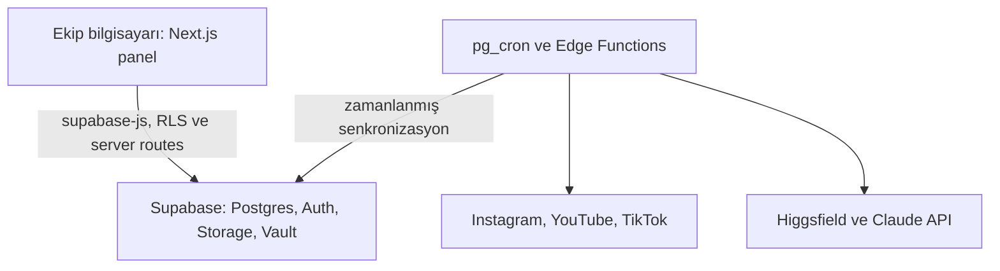

# ADR 0001: Admin Panel Teknoloji Yığını

- **Durum:** Önerildi
- **Tarih:** 2026-10-20
- **İlgili issue:** [#36](https://github.com/EBALCW/ai-influencer/issues/36)
- **Üst iş paketi:** [#63](https://github.com/EBALCW/ai-influencer/issues/63)

## Bağlam

Ekip üyeleri paneli kendi bilgisayarlarında kullanacak. Influencer, içerik, maliyet ve marka verileri ortak olmalı. Sosyal platform metriklerini toplama ve zamanlanmış işler, ekip bilgisayarları kapalı olsa da çalışmalı. Instagram, YouTube ve TikTok entegrasyonları OAuth callback'leri ve gizli API bilgileri gerektiriyor.

## Değerlendirilen seçenekler

| Seçenek                              | Ortak ekip verisi                                         | Bilgisayar kapalıyken işler       | OAuth ve gizli anahtarlar                                             | Geliştirme ve işletim                                                                  |
| ------------------------------------ | --------------------------------------------------------- | --------------------------------- | --------------------------------------------------------------------- | -------------------------------------------------------------------------------------- |
| **A. Next.js + Supabase**            | Supabase Postgres ile yerleşik                            | Edge Functions ve zamanlayıcı ile | Server-side route/Edge Function; sırlar sunucu tarafında              | TypeScript ekosistemiyle hızlı; yönetilen servis maliyeti ve sağlayıcı bağımlılığı var |
| **B. Tauri/Electron + yerel SQLite** | Bilgisayarlar arasında ayrıca eşitleme gerekir            | Her bilgisayar kapalıyken durur   | Her kurulumda token saklama ve yenileme karmaşıklaşır                 | Masaüstü dağıtımı ve güncelleme yükü ekler                                             |
| **C. FastAPI + React**               | Ayrı, sürekli çalışan ortak backend ve veritabanı gerekir | Sunucu altyapısı kurulursa mümkün | Backend'de çözülebilir; OAuth için yine erişilebilir callback gerekir | İki dil/uygulama yığını ve ek servis işletimi gerektirir                               |

## Karar

**A seçeneği** seçildi:

- Panel: **Next.js 16 App Router, TypeScript, Tailwind CSS ve shadcn/ui**.
- Workspace: **pnpm**, apps/panel ve packages/* yapısı.
- Ortak veri ve kimlik: **Supabase Postgres, Auth, Storage ve Row Level Security (RLS)**.
- Sunucu tarafı işler: **Supabase Edge Functions**; zamanlama için **pg_cron** veya Supabase'in desteklediği zamanlanmış iş mekanizması.
- Şema değişiklikleri: supabase/migrations; uygulama ve Edge Function'lar için ortak tipler packages/shared içinde tutulur.
- OAuth callback'leri geliştirmede Next.js route'larında, dağıtılmış akış gerektiğinde Edge Function veya erişilebilir sunucu callback'inde ele alınır. Her sağlayıcının izin verdiği redirect URI ve uygulama inceleme koşulları entegrasyon issue'sunda doğrulanır.
- Higgsfield, Claude ve sosyal platform API anahtarları tarayıcıya veya repoya konmaz; sunucu ortamında ya da Supabase Vault/Secrets içinde tutulur.
- Tauri/Electron ve yerel SQLite ilk sürüm kapsamına alınmaz. Masaüstü paketleme ihtiyacı doğarsa, ortak Supabase veri katmanı korunarak ayrıca değerlendirilir.

> **Sürüm notu (2026-10-21):** İskelet kurulurken güncel ana sürümler seçildi: Next.js 16, Tailwind CSS 4, ESLint 9 (flat config). Proje boşken major yükseltme en ucuz noktadır.

## Mimari

## Sonuçlar

### Olumlu

- Ekip aynı veriyi görür ve yetkilendirme RLS ile veritabanında uygulanır.
- Metrik toplama işleri bir kullanıcının bilgisayarına bağlı kalmaz.
- Tek bir TypeScript ağırlıklı uygulama ve ortak tip paketi geliştirme akışını sade tutar.
- Özel sağlayıcı anahtarları tarayıcıya gönderilmeden kullanılabilir.

### Maliyetler ve riskler

- Supabase için üretim maliyeti ve kota sınırları kullanıma açılmadan önce doğrulanmalı; başlangıçta ücretsiz katman uygunluğu kontrol edilebilir, ancak üretim için ücretsiz kalacağı varsayılmamalıdır.
- Supabase'e bağımlılık oluşur. SQL migration'ları ve sağlayıcıdan bağımsız iş mantığı bu bağımlılığı azaltır.
- OAuth izinleri, token yenileme ve platform uygulama incelemeleri ek iş gerektirir. Her entegrasyon kendi issue'sunda güncel resmi koşullara göre doğrulanmalıdır.
- Yerel panel adresleri geliştirme için uygundur; ekip dışı callback veya dağıtım gereken akışlarda kararlı HTTPS callback adresi sağlanmalıdır.
- Supabase erişim anahtarı, OAuth token'ları ve AI sağlayıcı sırları loglanmamalı veya istemci koduna eklenmemelidir.

## Önerilen depo yapısı

- apps/panel/ — Next.js kullanıcı arayüzü ve server routes
- packages/shared/ — Üretilmiş Supabase tipleri ve paylaşılan tipler
- supabase/migrations/ — Veritabanı migration'ları
- supabase/functions/ — Zamanlanmış işler ve sağlayıcı entegrasyonları
- docs/adr/ — Mimari karar kayıtları

## Sonraki adımlar

Bu karar, #37 proje iskeleti ve #38 veritabanı şeması için temel oluşturur. #49 OAuth ve sağlayıcı entegrasyonları sırasında redirect URI, izin kapsamları, token saklama ve sağlayıcı inceleme gereksinimleri tekrar doğrulanmalıdır.
