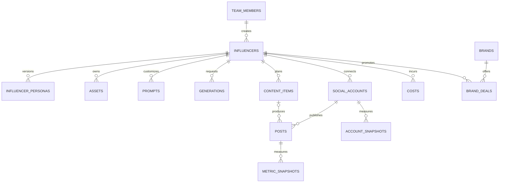

# Admin Panel Veri Modeli

Bu belge `supabase/migrations/20261021090000_initial_schema.sql` ile kurulan ilk sürüm şemasını açıklar. Proje ilk sürümde tek ekip/workspace içindir; bütün uygulama kayıtları aynı takım üyeliği ve RLS sınırını paylaşır.

## İlişkiler

`influencers.avatar_asset_id`, `generations.output_asset_id` ve `posts.content_item_id` isteğe bağlıdır. Üretilen varlıkları silmek, geçmiş üretim kayıtlarını silmez; varlık bağlantısı `NULL` olur.

## Tablolar

| Tablo                 | Sorumluluk                                     | Önemli kurallar                                                                                                                                                   |
| --------------------- | ---------------------------------------------- | ----------------------------------------------------------------------------------------------------------------------------------------------------------------- |
| `team_members`        | Supabase Auth kullanıcısının rolü              | `owner`, `editor`, `viewer`; son owner silinemez. İlk doğrulanmış kullanıcı yalnızca boş workspace'te owner olarak kaydolabilir.                                  |
| `influencers`         | Karakterin kimliği ve yaşam döngüsü            | Benzersiz URL dostu `slug`; durum `draft`, `active`, `paused`, `archived`.                                                                                        |
| `influencer_personas` | Persona metni ve versiyonları                  | Influencer başına versiyon numarası benzersiz; aynı anda en fazla bir güncel sürüm.                                                                               |
| `assets`              | Storage'daki görsel/video metadata'sı          | `storage_path` benzersiz; dosyanın kendisi private Storage bucket'ta tutulur.                                                                                     |
| `prompts`             | Global veya influencer'a özel prompt sürümleri | Soy = kapsam + kategori + `key`; versiyon başına bir satır. Versiyon içeriği **değiştirilemez** (trigger), yeni versiyon `create_prompt_version()` ile. Puan 1–5. |
| `generations`         | Görsel/video üretim isteği ve sonucu           | Sağlayıcı, durum, kredi, süre ve çıktı asset'i kaydedilir. `params` (jsonb) doldurulmuş prompt ve değişken değerlerini taşır; sır tutulmaz.                       |
| `social_accounts`     | Instagram, YouTube ve TikTok hesapları         | Token değeri değil, Vault secret referansı (`token_ref`) tutulur.                                                                                                 |
| `content_items`       | Fikirden yayına içerik akışı                   | Stage enum'u: `idea` → `script` → `production` → `qc` → `edit` → `scheduled` → `published`.                                                                       |
| `posts`               | Platformda yayınlanmış içerik                  | Hesap ve platform kimliğiyle eşleşir; içerik planından bağımsız içe aktarılabilir.                                                                                |
| `metric_snapshots`    | Post bazında zamanlı performans                | `views`, `likes`, `comments`, `shares`, `saves`; completion rate 0–1 aralığında.                                                                                  |
| `account_snapshots`   | Hesap seviyesinde takipçi ve erişim            | Hesap + zaman damgası başına tek snapshot.                                                                                                                        |
| `costs`               | Abonelik, kredi ve araç maliyeti               | Tutar ve para birimi sayısal alanlardır; üretim kaydına bağlanabilir.                                                                                             |
| `brands`              | Marka ve iletişim notları                      | İsim büyük/küçük harf duyarsız benzersizdir.                                                                                                                      |
| `brand_deals`         | Marka iş birliği süreci                        | Aşama, ücret, teslimatlar ve son tarih tutulur.                                                                                                                   |
| `alerts`              | Panel uyarıları                                | Tip serbest metindir; payload JSONB'dir, okundu zamanı `read_at` ile saklanır.                                                                                    |
| `budgets`             | Aylık bütçe tavanı                             | `influencer_id` NULL = tüm ekip toplamı. Ay başına tek bütçe (kısmi benzersiz indeksler). Sadece owner yazar.                                                     |
| `exchange_rates`      | Döviz kuru                                     | 1 `currency` = `rate` `base_currency`, `valid_on` gününden itibaren. Ters kur otomatik kullanılır. Sadece owner yazar.                                            |
| `credit_rates`        | Sağlayıcı kredisinin para karşılığı            | 1 kredi = `rate_per_credit` `currency`, `valid_from`'dan itibaren (`credits_to_money()`). Sadece owner yazar.                                                     |

Uygulama tablolarının tümünde `created_at`, `updated_at` ve `created_by` bulunur. `updated_at` trigger ile değiştirilir; `created_by` istemci isteklerinde `auth.uid()` ile dolar, demo seed kayıtlarında boş kalır.

## Persona versiyonlama (#44)

`influencer_personas` satırları **değişmez kayıtlardır**:

- Yeni versiyon yalnızca `create_persona_version(...)` RPC'siyle oluşturulur. Versiyon numarası (`max + 1`), `is_current` ve değiştiren kişi (`created_by`) veritabanında belirlenir. RPC influencer satırını `FOR UPDATE` ile kilitler, böylece eşzamanlı iki kayıt aynı numarayı alamaz.
- Geri alma (`restore_persona_version`) eski içeriği kopyalayan **yeni** bir versiyon oluşturur ve `restored_from_version` alanına kaynağı yazar. Geçmiş doğrusal kalır.
- Var olan satırın içeriği trigger ile kilitlidir. `UPDATE` sadece `is_current`'ı `true → false` yapabilir. Geçmişi sadece owner silebilir.
- `change_note`: versiyon notu (en fazla 500 karakter). `appearance`: görünüm alanları (saç, ten, göz, yüz, vücut, imza aksesuar). #43 wizard'ı da bu kolonu kullanır. `sample_captions`: persona tonunu örnekleyen, en fazla 10 caption (her biri en fazla 2.200 karakter); persona sürümüyle birlikte saklanır ve geri yüklenir.
- Panel tarafında form şeması `apps/panel/src/lib/persona.ts`, versiyon farkı `apps/panel/src/lib/persona-diff.ts` içindedir. jsonb alanlarındaki bilinmeyen anahtarlar yeni versiyona taşınır.

## İçerik akışı ve yayın takvimi (#57)

- `content_items`: trend URL/izlenme/viral neden/uyarlama puanı, sorumlu ekip üyesi, hedef sosyal hesap, IANA saat dilimi, sıra ve not alanları. Influencer sonradan değişmez. `updated_at` atomik kayıt RPC’sinde iyimser kilittir; eski sürümle kayıt 409 döner.
- `content_item_assets`: bir içerik ile aynı influencer’a ait asset veya üretimi bağlar (her satırda tam biri). RLS, audit trigger’ları ve tekil bağlantı kısıtları vardır.
- `posting_slots`: hesap, haftanın günü (Pazar=0), PostgreSQL `time` ve IANA saat dilimi. Viewer yalnız okur. DST’de mevcut olmayan slot saati takvimde uyarı olarak gösterilir.
- `save_content_item`: içerik ve medya bağlantılarını tek transaction’da kaydeder. `link_content_post`: `posts.content_item_id` üzerinden yayını eşleştirir; hesabı doğrular ve kartı Yayında’ya taşır. Fonksiyonlar `SECURITY INVOKER` kullanır.
- `checklist` biçimi: `{ items: { <madde>: boolean }, hookScore: 1..5 | null, engagementScore: 1..5 | null, decision: 'ready' | 'rework' | 'review' }`. Maddeler `templates/pre-publish-checklist.md` ile eşleşir. Eksik checklist, düşük puan, eksik hesap/zaman veya post eşleştirmesi planlama/yayın aşamasına geçişi veritabanında da engeller (API 422).
- 5 saat ve günlük 4 paylaşım kuralları uyarıdır. Planlanmış içerik ve gerçek postlar hesap bazında tek kez sayılır; günlük sınır kartın hedef saat diliminde hesaplanır. `content_item_details` yalnız seçili kartlar için son post snapshot’ını getirir; snapshot’lar toplanmaz.
- Kanban ve takvim 100 kartlık sayfalar kullanır; medya ve post seçimleri son 200 kayıtla sınırlıdır. Daha eski bağlı medyanın kimliği korunur.

## Prompt kütüphanesi (#46)

- **Soy (lineage):** `(influencer_id, category, key)`. `influencer_id` NULL ise global. Aynı kapsam ve kategoride farklı `key`'lerle birden çok prompt olabilir.
- **Versiyonlama:** `public.create_prompt_version(...)` (security invoker) bir sonraki versiyon numarasını advisory lock altında atomik olarak verir. Numara istemcide hesaplanmaz. Var olan satırda `body`, `negative`, `variables`, kapsam, kategori, `key` ve `version` değiştirilemez (`prompts_prevent_content_update`). Sadece `title`, `rating` ve `change_note` güncellenir. Böylece geçmiş üretimlerin bağlı olduğu metin değişmez.
- **Görünümler** (ikisi de `security_invoker = true`, ekip dışına satır göstermez):
  - `prompt_lineages`: her soyun en son versiyonu + `version_count`.
  - `prompt_stats`: versiyon başına `total`, `succeeded`, `failed`, `pending`, `success_rate` = başarılı / (başarılı + başarısız) (biten üretim yoksa NULL), `avg_credits` (sadece başarılılar).
- **Şablon sözdizimi:** `{{degisken}}`, kaçış `\{{`. Motor: `apps/panel/src/lib/prompt-template.ts`.

## Maliyet ve bütçe (#59)

- Para her yerde `numeric`. Farklı para birimleri dönüşümsüz toplanmaz: `cost_entries_converted()` her kaydı `incurred_on` gününün kuruyla (`fx_rate()`) hedef para birimine çevirir. Kuru bulunamayan kayıt sayılır ve toplamlar `NULL` döner, panel "eksik kur" uyarısı gösterir.
- Özetler SQL'de hesaplanır (`cost_summary`, `cost_daily`, `cost_by_category`, `budget_status`). Hepsi `SECURITY INVOKER`, çağıranın RLS'i geçerli.
  - **Video başına maliyet:** dönem toplam maliyeti / dönemde yayınlanan post sayısı. Post ↔ üretim bağı şemada henüz yok, bu yüzden video başına dağıtım yapılmıyor.
  - **1000 izlenme başına:** toplam maliyet × 1000 / dönemde yayınlanan postların en son izlenme toplamı.
  - **Başarısız üretim:** `generations.status = 'failed'` olan üretimler sayılır. Kredileri ve bağlı `costs` kayıtları toplama dahildir, ayrıca raporlanır.
- **Bütçe uyarıları:** `costs` veya `budgets` değişince trigger `raise_budget_alerts()`'ı çalıştırır. Oran `warn_ratio`'yu (varsayılan 0.8) geçince `budget_warning`, 1'i geçince `budget_exceeded` yazılır. Aynı bütçe, ay ve seviye için tek kayıt oluşur (`alerts_budget_dedupe_idx`). Uyarıyı tarayıcı değil veritabanı üretir.
- AI API maliyeti `cost_category = 'ai_api'` ile kaydedilir (`recordAiUsage()`).

## Yetki matrisi

| Rol                 | Uygulama verisini okuma | Uygulama verisi yazma | Takım üyelerini yönetme |
| ------------------- | ----------------------- | --------------------- | ----------------------- |
| `owner`             | Evet                    | Evet                  | Evet                    |
| `editor`            | Evet                    | Evet                  | Hayır                   |
| `viewer`            | Evet                    | Hayır                 | Hayır                   |
| Takım dışı / `anon` | Hayır                   | Hayır                 | Hayır                   |

Her uygulama tablosunda RLS açıktır. Anon rolüne tablo yetkisi verilmez; `authenticated` rolü tabloya erişse bile RLS yalnızca `team_members` içindeki kullanıcılara satır gösterir. Viewer için yazma politikası yoktur. Supabase `service_role` anahtarı RLS'i baypas edebildiği için sadece güvenilir sunucu işlerinde kullanılmalı ve asla tarayıcıya verilmemelidir.

## Yerel geliştirme ve tip üretimi

`assets.qc_checklist` QC kontrol yanıtlarını, `assets.thumbnail_path` ise private `assets` bucket'ındaki küçük resim yolunu tutar. Storage erişim politikaları üyeler için okuma, owner/editor için yazma ve silme izni verir.

`pnpm supabase:start` yerel Supabase'i başlatır. `pnpm supabase:db-reset` migration'ları ve `supabase/seed.sql` demo verisini sıfırdan uygular. `pnpm supabase:test` pgTAP testlerini çalıştırır; testler ilk owner kaydı, viewer salt-okunur davranışı, takım dışı erişim ve editor yazma yetkisini kontrol eder.

Şema değiştikten sonra `pnpm supabase:types` komutu `supabase gen types typescript --local` çıktısını `packages/shared/src/database.types.ts` dosyasına yazar. Bu dosya **elle düzenlenmez**; CI, migration'lardan üretilen tiplerle dosyanın aynı olduğunu kontrol eder ve fark varsa PR'ı düşürür. `Row<'influencers'>`, `TeamRole` gibi yardımcı tipler `packages/shared/src/database.ts` içindedir; panel kodu her zaman `@ai-influencer/shared` üzerinden import eder.

## Kapsam sınırları

- Bu model tek bir ortak ekip içindir. Birden çok müşteri/ekip workspace'i gerekirse her iş tablosuna `team_id` eklenmeli ve RLS politikaları workspace üyeliğine göre yeniden kurulmalıdır.
- Sosyal OAuth token'ları bu şemaya düz metin olarak yazılmaz; Vault secret adı veya kimliği `token_ref` alanında tutulur.
- Storage bucket oluşturma, dosya yükleme politikaları ve asset kullanıcı akışı #45 kapsamındadır.
- Paylaşım ve OAuth entegrasyonlarına özel alanlar, kendi issue'larında sağlayıcı koşulları doğrulandıkça migration ile eklenmelidir.
