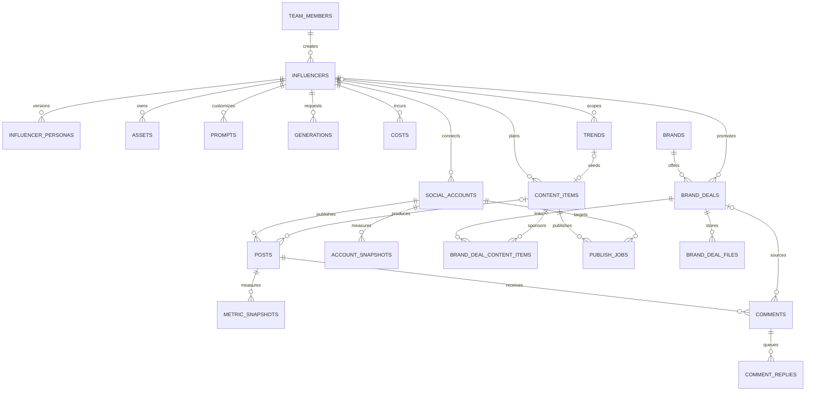

# Admin Panel Veri Modeli

Bu belge `supabase/migrations/20261021090000_initial_schema.sql` ile kurulan ilk sürüm şemasını açıklar. Proje ilk sürümde tek ekip/workspace içindir; bütün uygulama kayıtları aynı takım üyeliği ve RLS sınırını paylaşır.

## İlişkiler

`influencers.avatar_asset_id`, `generations.output_asset_id` ve `posts.content_item_id` isteğe bağlıdır. Üretilen varlıkları silmek, geçmiş üretim kayıtlarını silmez; varlık bağlantısı `NULL` olur.

## Tablolar

| Tablo                      | Sorumluluk                                     | Önemli kurallar                                                                                                                                                                                              |
| -------------------------- | ---------------------------------------------- | ------------------------------------------------------------------------------------------------------------------------------------------------------------------------------------------------------------ |
| `team_members`             | Supabase Auth kullanıcısının rolü              | `owner`, `editor`, `viewer`; son owner silinemez. İlk doğrulanmış kullanıcı yalnızca boş workspace'te owner olarak kaydolabilir.                                                                             |
| `influencers`              | Karakterin kimliği ve yaşam döngüsü            | Benzersiz URL dostu `slug`; durum `draft`, `active`, `paused`, `archived`.                                                                                                                                   |
| `influencer_personas`      | Persona metni ve versiyonları                  | Influencer başına versiyon numarası benzersiz; aynı anda en fazla bir güncel sürüm.                                                                                                                          |
| `assets`                   | Storage'daki görsel/video metadata'sı          | `storage_path` benzersiz; dosyanın kendisi private Storage bucket'ta tutulur.                                                                                                                                |
| `prompts`                  | Global veya influencer'a özel prompt sürümleri | Soy = kapsam + kategori + `key`; versiyon başına bir satır. Versiyon içeriği **değiştirilemez** (trigger), yeni versiyon `create_prompt_version()` ile. Puan 1–5.                                            |
| `generations`              | Görsel/video üretim isteği ve sonucu           | Sağlayıcı, durum, kredi, süre ve çıktı asset'i kaydedilir. `params` (jsonb) doldurulmuş prompt ve değişken değerlerini taşır; sır tutulmaz.                                                                  |
| `social_accounts`          | Instagram, YouTube ve TikTok hesapları         | Token değeri değil, Vault secret referansı (`token_ref`) tutulur.                                                                                                                                            |
| `content_items`            | Fikirden yayına içerik akışı                   | Stage enum'u: `idea` → `script` → `production` → `qc` → `edit` → `scheduled` → `published`.                                                                                                                  |
| `posts`                    | Platformda yayınlanmış içerik                  | Hesap ve platform kimliğiyle eşleşir; içerik planından bağımsız içe aktarılabilir.                                                                                                                           |
| `metric_snapshots`         | Post bazında zamanlı performans                | `views`, `likes`, `comments`, `shares`, `saves`; completion rate 0–1 aralığında. `target_hours` (1/5/24/72/168, NULL = ad-hoc) post başına benzersiz (#53). `source` `api`/`manual` (#52).                   |
| `account_snapshots`        | Hesap seviyesinde takipçi ve erişim            | Hesap + zaman damgası başına tek snapshot. `total_views` (YouTube) ve `total_likes` (TikTok) diğer platformlarda NULL.                                                                                       |
| `costs`                    | Abonelik, kredi ve araç maliyeti               | Tutar ve para birimi sayısal alanlardır; üretim kaydına bağlanabilir (üretim başına en fazla bir kayıt, biten üretimde otomatik yazılır).                                                                    |
| `brands`                   | Marka ve iletişim notları                      | İsim büyük/küçük harf duyarsız benzersizdir.                                                                                                                                                                 |
| `brand_deals`              | Marka iş birliği süreci                        | Aşama, ücret, teslimatlar, son tarih, brief (jsonb nesne) ve `paid_at` tutulur.                                                                                                                              |
| `brand_deal_content_items` | Deal ↔ içerik kartı bağlantısı                 | Çift başına tek satır; içerik deal ile aynı influencer'a ait olmalı (trigger, 23514).                                                                                                                        |
| `brand_deal_files`         | Deal dosyaları (sözleşme)                      | Nesne private `contracts` bucket'ında `<deal_id>/<uuid>.<uzantı>`; kayıt başka deal klasörünü gösteremez.                                                                                                    |
| `alerts`                   | Panel uyarıları                                | Tür listesi CHECK ile sabit (`ALERT_TYPES`); `dedupe_key` benzersiz; payload sadece id/sayı. Satırlar değiştirilmez.                                                                                         |
| `alert_reads`              | Kişi başı okundu bilgisi                       | `(alert_id, user_id)`; kullanıcı sadece kendi kaydını görür/yazar, viewer dahil.                                                                                                                             |
| `notification_settings`    | Uyarı eşikleri ve push kanal seçimi            | Tek satır. Ekip okur, owner/editor günceller. Kanal sırları Vault'ta.                                                                                                                                        |
| `budgets`                  | Aylık bütçe tavanı                             | `influencer_id` NULL = tüm ekip toplamı. Ay başına tek bütçe (kısmi benzersiz indeksler). Sadece owner yazar.                                                                                                |
| `exchange_rates`           | Döviz kuru                                     | 1 `currency` = `rate` `base_currency`, `valid_on` gününden itibaren. Ters kur otomatik kullanılır. Sadece owner yazar.                                                                                       |
| `credit_rates`             | Sağlayıcı kredisinin para karşılığı            | 1 kredi = `rate_per_credit` `currency`, `valid_from`'dan itibaren (`credits_to_money()`). Sadece owner yazar.                                                                                                |
| `reports`                  | Haftalık rapor (KPI özeti + AI özeti)          | `influencer_id` NULL = tümü; hafta başına tek kayıt (`NULLS NOT DISTINCT`). Sayılar `report_summary()` çıktısıdır. Ayrıntı: "Raporlama ve dışa aktarma".                                                     |
| `sync_runs`                | Senkronizasyon iş günlüğü (#53)                | İş/hesap başına bir satır; yalnız service role yazar, ekip okur. `failed` → `sync_failed` uyarısı. Ayrıntı: "Zamanlanmış senkronizasyon".                                                                    |
| `publish_jobs`             | Yayın kuyruğu (#58)                            | İçerik + hesap başına tek açık/yayınlanmış iş; worker alanları yalnız sunucu, istemci yalnız kuyruktaki işi iptal eder. Ayrıntı: "Yayınlama".                                                                |
| `comments`                 | Instagram/YouTube yorumları (#61)              | `(account_id, external_id)` benzersiz; yalnız service role yazar, editor yalnız `status`/`brand_deal_id` değiştirir. 90 gün saklanır. Ayrıntı: "Yorum gelen kutusu".                                         |
| `comment_replies`          | Yorum yanıt kuyruğu (#61)                      | Editor yalnız `comment_id` + `body` ekler; gönderimi Edge Function yapar. Yorum başına tek etkin yanıt (kısmi UNIQUE, `failed` hariç).                                                                       |
| `trends`                   | Trend ve viral içerik arşivi (#10)             | Link http(s) ve aynı kapsamda (global / influencer) benzersiz; puan 1–5; durum `new`/`shortlisted`/`used`/`rejected`. Backlog bağlantısı `content_item_id` (kart başına tek trend). Ayrıntı: "Trend arşivi". |

Uygulama tablolarının tümünde `created_at`, `updated_at` ve `created_by` bulunur. `updated_at` trigger ile değiştirilir; `created_by` istemci isteklerinde `auth.uid()` ile dolar, demo seed kayıtlarında boş kalır.

## Persona versiyonlama (#44)

`influencer_personas` satırları **değişmez kayıtlardır**:

- Yeni versiyon yalnızca `create_persona_version(...)` RPC'siyle oluşturulur. Versiyon numarası (`max + 1`), `is_current` ve değiştiren kişi (`created_by`) veritabanında belirlenir. RPC influencer satırını `FOR UPDATE` ile kilitler, böylece eşzamanlı iki kayıt aynı numarayı alamaz.
- Geri alma (`restore_persona_version`) eski içeriği kopyalayan **yeni** bir versiyon oluşturur ve `restored_from_version` alanına kaynağı yazar. Geçmiş doğrusal kalır.
- Var olan satırın içeriği trigger ile kilitlidir. `UPDATE` sadece `is_current`'ı `true → false` yapabilir. Geçmişi sadece owner silebilir.
- `change_note`: versiyon notu (en fazla 500 karakter). `appearance`: görünüm alanları (saç, ten, göz, yüz, vücut, imza aksesuar). #43 wizard'ı da bu kolonu kullanır. `sample_captions`: persona tonunu örnekleyen, en fazla 10 caption (her biri en fazla 2.200 karakter); persona sürümüyle birlikte saklanır ve geri yüklenir.
- Panel tarafında form şeması `apps/panel/src/lib/persona.ts`, versiyon farkı `apps/panel/src/lib/persona-diff.ts` içindedir. jsonb alanlarındaki bilinmeyen anahtarlar yeni versiyona taşınır.

## İçerik akışı ve yayın takvimi (#57)

- `content_items`: trend URL/izlenme/viral neden/uyarlama puanı, sorumlu ekip üyesi, hedef sosyal hesap, IANA saat dilimi, sıra ve not alanları. Influencer sonradan değişmez. `updated_at` atomik kayıt RPC’sinde iyimser kilittir; eski sürümle kayıt 409 döner.
- `content_item_assets`: bir içerik ile aynı influencer’a ait asset veya üretimi bağlar (her satırda tam biri). RLS, audit trigger’ları ve tekil bağlantı kısıtları vardır.
- `posting_slots`: hesap, haftanın günü (Pazar=0), PostgreSQL `time` ve IANA saat dilimi. Viewer yalnız okur. DST’de mevcut olmayan slot saati takvimde uyarı olarak gösterilir.
- `save_content_item`: içerik ve medya bağlantılarını tek transaction’da kaydeder. `link_content_post`: `posts.content_item_id` üzerinden yayını eşleştirir; hesabı doğrular ve kartı Yayında’ya taşır. Fonksiyonlar `SECURITY INVOKER` kullanır.
- `checklist` biçimi: `{ items: { <madde>: boolean }, hookScore: 1..5 | null, engagementScore: 1..5 | null, decision: 'ready' | 'rework' | 'review' }`. Maddeler `templates/pre-publish-checklist.md` ile eşleşir. Eksik checklist, düşük puan, eksik hesap/zaman, post eşleştirmesi, puanlayan = üreten veya v2v'de eksik kaynak bilgisi planlama/yayın aşamasına geçişi veritabanında da engeller (API 422; ayrıntı aşağıda).
- 5 saat ve günlük 4 paylaşım kuralları uyarıdır. Planlanmış içerik ve gerçek postlar hesap bazında tek kez sayılır; günlük sınır kartın hedef saat diliminde hesaplanır. `content_item_details` yalnız seçili kartlar için son post snapshot’ını getirir; snapshot’lar toplanmaz.
- Kanban ve takvim 100 kartlık sayfalar kullanır; medya ve post seçimleri son 200 kayıtla sınırlıdır. Daha eski bağlı medyanın kimliği korunur.

### Kaynak alanları ve puanlayan (#145, #22)

Migration `20261024100000_content_source_fields.sql`.

- **v2v içerik:** İçeriğe `generations.mode = 'video_to_video'` olan bir üretim ya da böyle bir üretimin çıktı asset'i (`output_asset_id`) bağlıysa (`content_is_v2v(id)`). `format` serbest metindir, ölçüt değildir.
- **Kaynak kolonları:** `source_type` (`content_source_type` enum: `own` · `stock` · `open_license` · `third_party`; NULL = v2v değil veya girilmedi), `source_owner` (≤ 200; herkese açık hesap/kanal adı veya stok sağlayıcı, kişisel veri yazılmaz), `source_license` (≤ 500; lisans adı/no veya kısıtlı depodaki izin belgesinin referansı). `own` dışındaki türlerde sahip ve lisans zorunludur (`content_items_source_details_required`, 23514). Kaynak videonun bağlantısı `source_url`'de kalır.
- **`source_checked_at` / `source_checked_by`:** Kaynak alanları değiştiğinde trigger oturumdaki kullanıcıyı ve zamanı yazar; istemcinin gönderdiği değer yok sayılır. Alanlar boşaltılınca NULL olur. Oturumsuz (service role) yazımda zaman yine doldurulur.
- **Engeller (23514, HINT):** v2v içerikte `source_type` boşsa kart `scheduled`/`published` olamaz, `publish_jobs` satırı açılamaz ve planlı karta v2v üretimi/çıktısı bağlanamaz (`source_missing`).
- **`checklist_scored_by`:** `hookScore`, `engagementScore` veya `decision` değiştiğinde oturumdaki kullanıcıya sabitlenir (istemci yazamaz; service role yazımında verilen değer korunur). Üreten = `assignee_id`, atanmamışsa `created_by`. Puanlayan üretenle aynıysa kart planlanamaz ve yayın işi açılamaz (`scorer_is_producer`). Puanlayan bilinmiyorsa (NULL: oturumsuz veya bu migration öncesi puanlama) kural uygulanmaz.
- **Check-list:** `engagement_hashtags` ("Caption şablonu hazır; 3–5 alakalı hashtag…") eklendi; `content_checklist_ready()` 25 madde ister. Worker (`supabase/functions/_shared/publishers/checklist.ts`) aynı listeyi kullanır.
- **Geçiş:** Zaten `scheduled`/`published` olan kartta check-list, sorumlu ve kaynak alanları değişmeden yapılan güncellemeler (post eşleştirme, `complete_publish_job`, saat değişikliği) yeni kurallarla yeniden denetlenmez. Notlardaki geçerli `[Kaynak]` blokları (tür + `own` dışında sahip ve lisans) migration'da kolonlara taşındı; notlar silinmedi.
- **Aylık kontrol:** `content_source_missing_ids(p_influencer_id?)` kaynak bilgisi eksik v2v içeriklerin kimliklerini döner (RLS geçerli). Panel `/content?source=missing` filtresi ve karttaki "Kaynak bilgisi eksik (v2v)" etiketi bunu kullanır; `content_item_details` `v2v` ve `source_missing` alanlarını da döner.

## Prompt kütüphanesi (#46)

- **Soy (lineage):** `(influencer_id, category, key)`. `influencer_id` NULL ise global. Aynı kapsam ve kategoride farklı `key`'lerle birden çok prompt olabilir.
- **Versiyonlama:** `public.create_prompt_version(...)` (security invoker) bir sonraki versiyon numarasını advisory lock altında atomik olarak verir. Numara istemcide hesaplanmaz. Var olan satırda `body`, `negative`, `variables`, kapsam, kategori, `key` ve `version` değiştirilemez (`prompts_prevent_content_update`). Sadece `title`, `rating` ve `change_note` güncellenir. Böylece geçmiş üretimlerin bağlı olduğu metin değişmez.
- **Görünümler** (ikisi de `security_invoker = true`, ekip dışına satır göstermez):
  - `prompt_lineages`: her soyun en son versiyonu + `version_count`.
  - `prompt_stats`: versiyon başına `total`, `succeeded`, `failed`, `pending`, `success_rate` = başarılı / (başarılı + başarısız) (biten üretim yoksa NULL), `avg_credits` (sadece başarılılar).
- **Şablon sözdizimi:** `{{degisken}}`, kaçış `\{{`. Motor: `apps/panel/src/lib/prompt-template.ts`.
- **İçe/dışa aktarma:** `/prompts` sayfasından seçilen veya filtredeki tüm prompt'ların son versiyonları tek bir JSON paketi olarak indirilir (`GET /api/prompts/export`, ekip üyesi). Paket aynı sayfadan geri yüklenir (`POST /api/prompts/import`, en az editor): her prompt `create_prompt_version()` ile yeni versiyon olur, son versiyonla aynı içerik atlanır. Paket önce bütünüyle doğrulanır (Zod, `apps/panel/src/lib/prompt-bundle.ts`); tek hata varsa hiçbir şey yazılmaz. Influencer'lar ortamlar arası `slug` ile taşınır. **Repo public olduğu için prompt dosyaları repoya commit'lenmez** (`.gitignore`: `/prompts/`, `ai-influencer-prompts-*.json`); ekibin kısıtlı paylaşım alanında saklanır.
- **AI asistanı:** görev → soy eşlemesi `docs/AI.md` → Yapılandırma.

## Maliyet ve bütçe (#59)

- Para her yerde `numeric`. Farklı para birimleri dönüşümsüz toplanmaz: `cost_entries_converted()` her kaydı `incurred_on` gününün kuruyla (`fx_rate()`) hedef para birimine çevirir. Kuru bulunamayan kayıt sayılır ve toplamlar `NULL` döner, panel "eksik kur" uyarısı gösterir.
- Özetler SQL'de hesaplanır (`cost_summary`, `cost_daily`, `cost_by_category`, `budget_status`). Hepsi `SECURITY INVOKER`, çağıranın RLS'i geçerli.
  - **Video başına maliyet (dönem):** dönem toplam maliyeti / dönemde yayınlanan post sayısı (`cost_summary.cost_per_video`).
  - **Post başına maliyet:** `post_cost(post_id, currency)` (panelde `getPostCost()`, `apps/panel/src/lib/costs/post-cost.ts`). Bağ: post → `content_item_id` → `content_item_assets` → üretim (doğrudan `generation_id` veya `asset_id = generations.output_asset_id`). Bağlı üretim varsa `allocation = 'direct'` ve toplam bu üretimlerin maliyet kayıtlarıdır; aynı içerik birden çok hesapta yayınlandıysa her post içeriğin tüm maliyetini gösterir (bölüştürülmez). Bağlı üretim yoksa `allocation = 'average'` ve postun yayın ayındaki influencer ortalaması döner. `SECURITY INVOKER`: ekip dışı kullanıcıya satır dönmez.
  - **1000 izlenme başına:** toplam maliyet × 1000 / dönemde yayınlanan postların en son izlenme toplamı.
  - **Başarısız üretim:** `generations.status = 'failed'` olan üretimler sayılır. Kredileri ve bağlı `costs` kayıtları toplama dahildir, ayrıca raporlanır.
- **Bütçe uyarıları:** `costs` veya `budgets` değişince trigger `private.raise_budget_alerts()`'ı (SECURITY DEFINER) çalıştırır. Oran `warn_ratio`'yu (varsayılan 0.8) geçince `budget_warning`, 1'i geçince `budget_exceeded` yazılır. Aynı bütçe, ay ve seviye için tek kayıt oluşur (`alerts_budget_dedupe_idx`). Uyarıyı tarayıcı değil veritabanı üretir; `alerts` tablosunda istemci INSERT politikası yoktur (20261024120000).
- **Üretim maliyeti otomatik:** `generations` satırı `succeeded` veya `failed` olduğunda ve `cost_usd > 0` ya da `credits > 0` ise trigger (`generations_record_cost`) `costs`'a tek bir `credits` kategorili kayıt yazar: `cost_usd` doluysa tutar doğrudan o (USD, kredi fiyatı gerekmez; #150, migration `20261024130000`), değilse `credits_to_money(tool, credits, üretim günü)`, `generation_id` bağlı, `incurred_on` = üretimin oluşturulduğu gün. Başarısız üretim de yazılır (kredi harcanmıştır); `cancelled` ve kredisiz üretim yazılmaz. `costs.generation_id` benzersizdir: durum tekrar değişse veya kredi sonradan güncellense de ikinci kayıt oluşmaz, mevcut kayıt ezilmez. Kredi fiyatı yoksa kayıt yazılmaz (yanlış 0 yerine); owner `credit_rates`'e fiyat girince `valid_from`'dan itibaren biten ve kaydı olmayan üretimler otomatik tamamlanır. Fiyat değişikliği eski kayıtları yeniden fiyatlandırmaz.
- AI API maliyeti `cost_category = 'ai_api'` ile kaydedilir (`recordAiUsage()`, `/api/ai/suggest` her Claude çağrısından sonra çağırır; yazılamazsa öneri dönmez).

## Bildirimler (#56)

Migration: `20261022210000_notifications.sql`. Uyarıyı tarayıcı üretmez; üreticiler veritabanındadır ve API rollerine kapalı `private` şemasında `SECURITY DEFINER` fonksiyonlardır. Her uyarı `private.raise_alert()` ile `dedupe_key` üzerinden tekrarsız yazılır.

| Tür                                  | Ne zaman                                                                                                                                                          | `dedupe_key`                                  |
| ------------------------------------ | ----------------------------------------------------------------------------------------------------------------------------------------------------------------- | --------------------------------------------- |
| `viral_post`                         | `metric_snapshots` ilk saat (`target_hours = 1` veya `hours_since_publish <= 1`) izlenmesi, hesabın son 30 postunun ilk saat ortalamasının N katı (en az 3 örnek) | `viral_post:<post_id>`                        |
| `follower_milestone`                 | `account_snapshots` önceki en yüksek değerin üstündeki en büyük eşiği geçince (ilk snapshot temel alınır)                                                         | `follower_milestone:<account_id>:<eşik>`      |
| `token_expiring`                     | `social_accounts.token_expires_at` ayardaki gün sayısından yakınsa (trigger + pg_cron)                                                                            | `token_expiring:<account_id>:<bitiş günü>`    |
| `sync_failed`                        | `social_accounts.status` `error` olunca veya `sync_runs.status` `failed` olunca (#53, aynı anahtar)                                                               | `sync_failed:<account_id>:<gün>`              |
| `budget_warning` / `budget_exceeded` | Bütçe oranı `warn_ratio` (varsayılan %80) / %100 (#59, `alerts_budget_dedupe_idx`)                                                                                | —                                             |
| `content_not_ready`                  | Son 24 saatte yayın saati gelen, `scheduled`/`published` olmayan içerik (pg_cron, 15 dk)                                                                          | `content_not_ready:<id>:<scheduled_at epoch>` |
| `generation_failed`                  | `generations.status` `failed` olunca                                                                                                                              | `generation_failed:<id>`                      |
| `weekly_report_ready`                | Pazartesi otomatik haftalık rapor oluşunca (#62, pg_cron)                                                                                                         | `weekly_report_ready:<report_id>`             |
| `quota_warning`                      | O Pasifik günündeki YouTube `sync_runs.quota_units` toplamı `notification_settings.youtube_quota_warn_units`'i (varsayılan 8.000) geçince (#51, trigger)          | `quota_warning:youtube:<Pasifik günü>`        |
| `publish_failed`                     | `publish_jobs.status` `failed` veya `manual_required` olunca (#58, trigger; payload `status`)                                                                     | `publish_failed:<publish_job_id>`             |

- **Okundu kararı:** kişi başı (`alert_reads`). Viewer da kendi okundu kaydını yazar, `alerts` satırına UPDATE politikası yoktur. `alerts.read_at` kullanılmaz. RPC'ler: `mark_alerts_read(p_alert_ids uuid[] DEFAULT NULL)` (NULL = tümü) ve `unread_alert_count()`; ikisi de `SECURITY INVOKER`.
- **Zamanlayıcı:** `pg_cron` işi `raise-scheduled-alerts` 15 dakikada bir `private.raise_scheduled_alerts()` çalıştırır.
- **Push (opsiyonel):** Yeni uyarıda `notification_settings`'te açık olan ve sırrı tanımlı kanallara `pg_net` ile asenkron istek gider. Metin sadece uyarı başlığıdır (isim/token yok). Kanal hatası (istek oluşturulamaması veya sağlayıcının 500 dönmesi) uyarı yazımını etkilemez; loga adres/token yazılmaz. Kanal başına 10 dakikada en çok 20 push gider (`private.alert_push_limit()`, sayaç `private.alert_push_log`); fazlası atlanır ve LOG satırı yazılır, uyarı panelde yine görünür. Sırlar Supabase Vault'ta (Dashboard → Vault) şu adlarla tutulur:

  | Kanal    | Vault sır adları                                                                      |
  | -------- | ------------------------------------------------------------------------------------- |
  | ntfy     | `notify_ntfy_url` (`https://sunucu/konu`), ops. `notify_ntfy_token`                   |
  | Telegram | `notify_telegram_bot_token`, `notify_telegram_chat_id`                                |
  | E-posta  | `notify_resend_api_key`, `notify_email_from`, `notify_email_to` (virgülle birden çok) |

- **Panel:** üst bardaki zil (`components/notifications.tsx`, 60 sn'de bir yenilenir), `/notifications` listesi ve `/settings/notifications` (eşikler + kanal seçimi, owner/editor). API: `GET /api/alerts`, `POST /api/alerts/[id]/read`, `POST /api/alerts/read-all`, `GET|PUT /api/notification-settings`.
- **Yeni tür eklerken:** migration'da `alerts_type_known` CHECK'ini ve `private.alert_push_title()`'ı, `packages/shared/src/alerts.ts`'teki `ALERT_TYPES`'ı ve `apps/panel/src/lib/alerts/format.ts`'i birlikte güncelle (Vitest listelerin eşitliğini denetler).

## Üretim kuyruğu (#47)

Migration: `20261022230000_generation_queue.sql`. Worker: `supabase/functions/process-generations/` (Deno Edge Function). Sağlayıcı adaptörü: `supabase/functions/_shared/generation/` (Higgsfield, ADR 0002).

- **Yeni kolonlar (`generations`):** `mode` (`text_to_image` · `image_to_video` · `video_to_video`; verilmezse türden türetilir, `type` ile tutarlı olmalı), `provider_job_id`, `progress` (0–100), `attempts` / `max_attempts` (varsayılan 3), `next_run_at`, `started_at`, `finished_at`, `cancel_requested_at`, `retry_of`; #150 ile `estimated_cost_usd` (gönderim öncesi sağlayıcı tahmini) ve `cost_usd` (gerçekleşen tutar). Worker kolonlarını yalnız sunucu (service role / RPC) değiştirir: istemci INSERT'inde varsayılana çekilir, UPDATE'te `42501`. Worker kolonlarını yalnız sunucu (service role / RPC) değiştirir. İstemci (owner/editor) satırı yalnız `enqueue_generation()` ile açabilir: doğrudan INSERT `42501` (bütçe koruması atlanamaz); RPC içinde de durum `queued`a, kredi/sonuç alanları boşa çekilir, `params.budget_override_by` yalnız owner onayında RPC tarafından yazılır. İstemci UPDATE'i hiçbir kolonu değiştiremez (`42501`); durumu worker ilerletir, iptal `cancel_generation()` ile.
- **`params`:** `prompt`, `negative`, `variables`, `prompt_version`, `test_mode` (varsayılan açık: 480p, video en çok 5 sn), `resolution`, `duration_seconds`, `seed`, `model_params`; owner bütçe onayında `budget_override_by`.
- **`generation_worker_status`:** tek satır; worker'ın son çalışması ve yapılandırılmış sağlayıcılar. `providers` boşsa panel "sağlayıcı yapılandırılmamış" gösterir. Ekip okur, yalnız service role yazar.
- **RPC'ler:**
  | Fonksiyon                                            | Kim                            | Ne yapar                                                                                                                                                                                                                                                            |
  | ---------------------------------------------------- | ------------------------------ | ------------------------------------------------------------------------------------------------------------------------------------------------------------------------------------------------------------------------------------------------------------------- |
  | `enqueue_generation(...)`                            | editor+ (INVOKER)              | Bütçe kontrolü + ekleme tek transaction'da (advisory lock). Ayın toplam/influencer bütçesi dolduysa (`budget_status.ratio >= 1`) `P0001` + hint `budget_exceeded` (panel 402); owner `p_override_budget` ile açar. Referans asset'ler aynı influencer'a ait olmalı. |
  | `retry_generation(id, override)`                     | editor+                        | Sadece `failed`/`cancelled`: aynı parametrelerle **yeni** satır (`retry_of`), eski satır ve maliyeti değişmez.                                                                                                                                                      |
  | `cancel_generation(id)`                              | editor+ (INVOKER → `internal`) | Gönderilmemiş iş anında `cancelled`; gönderilmiş işte `cancel_requested_at` işaretlenir, worker sağlayıcıda iptal eder (başlamışsa iptal reddedilir, iş izlenmeye devam eder).                                                                                      |
  | `claim_generations(tools, limit, lease)`             | service role                   | `FOR UPDATE SKIP LOCKED` + kira: zamanı gelmiş `queued`/`running` işleri alır, `next_run_at`'i kira kadar ileri atar.                                                                                                                                               |
  | `complete_generation(id, path, mime, size, credits)` | service role                   | `assets` satırı (`kind = generated`, `<influencer_id>/generated-<id>.<ext>`) + üretimi `succeeded` olarak tek transaction'da bağlar; tekrar çağrı aynı asset'i kullanır.                                                                                            |
- **Worker akışı:** pg_cron her dakika `private.invoke_generation_worker()` → pg_net `POST /functions/v1/process-generations` (`x-cron-secret`). Vault'ta `project_url` veya `cron_secret` yoksa ya da zamanı gelmiş iş yoksa çağrı yapılmaz. `project_url` `https://` olmalı (yalnız `localhost`, `127.0.0.1`, `host.docker.internal`, `kong` için `http://`; `private.valid_project_url()`), aksi halde hiçbir zamanlanmış çağrı yapılmaz. Gönderim `Idempotency-Key = generations.id`; geçici hatalar (`rejected`, `timeout`, `unavailable`) üstel geri çekilmeyle (30 sn, 60 sn …, en çok 15 dk) `max_attempts`'a kadar tekrar denenir; kalıcı hatalar hemen `failed`. Yoklama 15 sn'de bir; `running` iş 30 dk'da (`GENERATION_RUNNING_TIMEOUT_MINUTES`) bitmezse `failed`. Sonuç dosyası indirilip `assets` bucket'ına yüklenir (en çok 100 MiB). Gönderim `Idempotency-Key = generations.id`; geçici hatalar (`timeout`, `unavailable`; Higgsfield 423/5xx, 503 `admission_control_unavailable`) üstel geri çekilmeyle (30 sn, 60 sn …, en çok 15 dk; `Retry-After` daha uzunsa o) `max_attempts`'a kadar tekrar denenir. 429 `account_queue_full` (`rate_limited`) deneme hakkı harcamadan `Retry-After` kadar ertelenir. Kalıcı hatalar (400/422 geçersiz parametre, 401, 403 bakiye, 404) hemen `failed`; hata mesajında varsa sağlayıcının `X-Correlation-ID`'si yer alır. Gönderimden önce `POST /estimate/<model>` tahmini `estimated_cost_usd`'ye yazılır. Referans dosyalar `POST /files/generate-upload-url` ile sağlayıcıya yüklenir; yüklenen URL'ler `params.provider_inputs`'ta saklanır ve tekrar denemede aynı gövde gider. Çıktının türü indirilen dosyanın `Content-Type`'ından, genel başlıkta URL uzantısından, o da yoksa moddan belirlenir; yalnız ses çıktısı desteklenmez. Status yanıtındaki `expires_at` geçmişse iş indirilmeden `failed` olur. Yoklama 15 sn'de bir; `running` iş 30 dk'da (`GENERATION_RUNNING_TIMEOUT_MINUTES`) bitmezse `failed`. Sonuç dosyası indirilip `assets` bucket'ına yüklenir (en çok 100 MiB).
- **Maliyet ve uyarı:** worker `costs`'a doğrudan yazmaz. Başarılı işte tahmini tutarı `cost_usd`'ye yazar (Higgsfield yalnız başarılı isteği ücretlendirir, status'ta tutar yok), `complete_generation` durumu değiştirince `generations_record_cost` trigger'ı kaydı yazar. Başarısız/nsfw/iptal iş iade edildiği için `cost_usd` yazılmaz. `failed` olunca `generation_failed` uyarısı oluşur.
- **Panel:** `/production` kuyruk sayfası (durum, ilerleme, hata, iptal / yeniden dene; viewer salt okunur, 10 sn'de bir yenilenir). Üretim formu prompt detayında (`/prompts/[id]`): mod, referans dosyalar, test modu, owner bütçe onayı ve yalnız modun desteklediği alanlar (görsel: 2K/4K + en-boy oranı; görselden video: süre 5/10 sn; video-to-video: 480p/720p/1080p). Seed yok. Kuyruk listesi tahmini/gerçek USD tutarı gösterir. API: `POST /api/generations/[id]/cancel`, `POST /api/generations/[id]/retry` (editor; bütçe 402, durum çakışması 409).

## Zamanlanmış senkronizasyon (#53)

Migration: `20261022231000_scheduled_sync.sql`. Toplama işi Edge Function `sync-dispatch`'te koşar (`supabase/functions/`, bkz. `docs/DEVELOPMENT.md` §9). Platform toplayıcıları `supabase/functions/_shared/collectors/` altındadır (sözleşme: `types.ts`, nasıl eklenir: `README.md`).

| pg_cron işi        | Zaman (UTC)    | Ne yapar                                                                                                     |
| ------------------ | -------------- | ------------------------------------------------------------------------------------------------------------ |
| `sync-metrics`     | `*/15 * * * *` | `due_snapshots(now())` → zamanı gelen postların metrik snapshot'ı (`target_hours` ile)                       |
| `sync-posts`       | `7,37 * * * *` | Bağlı hesapların yeni postları → `posts` upsert                                                              |
| `sync-accounts`    | `20 3 * * *`   | Hesap istatistikleri → `account_snapshots` (gün başına bir satır, UTC günü)                                  |
| `sync-maintenance` | `50 * * * *`   | `private.maintain_sync_runs()`: 1 saatten uzun `running` satırı `failed` yapar, 90 günden eski günlüğü siler |

- **Kontrol noktaları:** 1, 5, 24, 72 ve 168 saat. `due_snapshots(p_at, p_limit = 500, p_account_id = NULL)` zamanı parametre alır (service role'e açık). Hedef, #55 penceresi içindeyse "due" olur: 1:[1,2), 5:[5,7), 24:[24,30), 72:[72,84), 168:[168,192) saat. Cron 15 dakikada bir çalıştığı için snapshot hedeften en geç ~15 dk sonra alınır. Pencere kaçarsa o nokta boş kalır, yanlış saate etiket yazılmaz.
- **Idempotency:** `UNIQUE (post_id, target_hours)`. Fonksiyon `ON CONFLICT DO NOTHING` ile yazar, cron'un iki kez çalışması duplicate üretmez. `hours_since_publish` gerçek geçen süredir. `post_checkpoint_views()` (#55) `target_hours`'u olan satırı önceliklidir, eski satırlarda pencere kuralı geçerlidir.
- **Upsert kararı (#50/#51):** `posts (account_id, external_id)` ve `social_accounts (platform, external_id)` artık düz `UNIQUE` kısıttır (eski kısmi indeksler kaldırıldı, NULL'lar yine çakışmaz). supabase-js `upsert(..., { onConflict: 'account_id,external_id' })` çalışır.
- **Hesap seçimi:** `status IN ('active','error')` ve `token_ref` dolu. Token hatası → `expired` ya da `error` (`error` #56 `sync_failed` uyarısı üretir). Hatalı hesap başarılı senkronda `active`'e döner. Toplayıcısı kayıtlı olmayan platformun hesapları atlanır (günlük satırı yok).
- **Rate limit / kota:** hesaplar sırayla işlenir. Kısa `Retry-After` (≤30 sn) beklenir, daha uzunsa iş `partial` olarak bırakılır ve sonraki cron'a kalır. Geçici hatalar 3 denemeye kadar üstel backoff alır. Fonksiyon ~120 sn süre bütçesini aşınca kalan hesaplar sonraki çalışmaya kalır.
- **`sync_runs`:** `job` (`metrics`/`posts`/`accounts`/`manual`; #61: `comments`/`comment_reply`), `platform`, `account_id`, `started_at`, `finished_at` (kapanırken veritabanı saatiyle dolar), `status` (`running`/`succeeded`/`partial`/`failed`), `processed_count`, `quota_units`, `error` (temizlenmiş, ≤500 karakter, token yok). RLS: ekip okur. `authenticated` rolüne yazma yetkisi verilmez.
- **Şimdi senkronize et:** `/settings/sync` → `POST /api/sync` (editor+) → `request_sync(p_account_id?)` RPC'si (`SECURITY INVOKER` sarmalayıcı; Vault ve `private`'a erişen gövde `internal.request_sync`, `SECURITY DEFINER`, owner/editor denetimi). Dönüş: `queued` (202), `throttled` (429, 2 dk içinde ikinci istek), `not_configured` (503), `not_found` (404). Çağrı veritabanındaki Vault sırrıyla pg_net üzerinden yapılır, panel `CRON_SECRET`'ı görmez. Kim istediği `private.sync_requests`'te tutulur.
- **Ortam kurulumu (her ortamda bir kez, owner):** Edge Function sırrı `supabase secrets set CRON_SECRET=<rastgele>`. Vault'ta (Dashboard → Vault) `cron_secret` (aynı değer) ve `project_url` (`https://<ref>.supabase.co`, sonda `/` yok). Sırlar yoksa cron işleri sessizce atlanır (Postgres LOG satırı).

### YouTube toplayıcı (#51)

Migration: `20261022233000_youtube_collector.sql`. Kod: `supabase/functions/_shared/collectors/youtube.ts` + `_shared/youtube/` (istemci, eşleme, kota). Ayrıntılı alan eşlemesi ve kota tahmini: `supabase/functions/_shared/collectors/README.md` → "YouTube".

| API alanı                                                         | Kolon                                                                                   |
| ----------------------------------------------------------------- | --------------------------------------------------------------------------------------- |
| `channels.statistics.subscriberCount`                             | `account_snapshots.followers` (gizliyse 0 + uyarı)                                      |
| `channels.statistics.videoCount`                                  | `account_snapshots.media_count`                                                         |
| `channels.statistics.viewCount`                                   | `account_snapshots.total_views` (yeni kolon, diğer platformlarda NULL)                  |
| `videos.id` / `snippet.publishedAt`                               | `posts.external_id` / `posts.published_at`                                              |
| `snippet.title` + `snippet.description`                           | `posts.caption` (başlık, boş satır, açıklama)                                           |
| `contentDetails.duration` (ISO 8601)                              | `posts.duration_s`                                                                      |
| süre + `player.embedWidth/embedHeight`                            | `posts.is_short` (≤180 sn ve dikey/kare; boyut yoksa ≤60 sn), `posts.url` (`/shorts/…`) |
| `videos.statistics.viewCount/likeCount/commentCount`              | `metric_snapshots.views/likes/comments`                                                 |
| Analytics `shares`                                                | `metric_snapshots.shares` (Analytics yoksa 0 + `_unmeasured`)                           |
| Analytics `averageViewDuration`                                   | `metric_snapshots.avg_watch_time_s`                                                     |
| Analytics `averageViewPercentage`                                 | `metric_snapshots.completion_rate` (÷100, 1'e kırpılır)                                 |
| Analytics `estimatedMinutesWatched`, `subscribersGained`, `views` | `metric_snapshots.raw_payload.analytics`                                                |

- **Analytics gecikmesi:** 1 ve 5 saat noktalarında yalnız Data API sayaçları yazılır. 24 saatten itibaren Analytics sorgulanır; boş dönerse snapshot Data API sayaçlarıyla yine yazılır (`raw_payload.analyticsState = 'empty'`) ve izleme süresi/tamamlama sonraki noktada (72/168 sa) dolar. Snapshot (post, nokta) başına bir kez yazıldığı için aynı nokta sonradan güncellenmez.
- **Kota:** her çalışmanın Data API birimi `sync_runs.quota_units`'e yazılır. Analytics API bu kotaya dahil değildir. Eşik geçilince `quota_warning` uyarısı (bkz. Bildirimler). Kota dolarsa (`quotaExceeded`) o çalışmada YouTube hesaplarının tamamı atlanır, iş `partial` kalır.

### TikTok toplayıcı ve elle metrik girişi (#52)

Migration: `20261022242000_tiktok_manual_metrics.sql`. Kod: `supabase/functions/_shared/collectors/tiktok.ts` + `_shared/tiktok/` (istemci, eşleme). Alan eşlemesi, sayfalama, hata eşleme ve TikTok uygulama kurulumu: `supabase/functions/_shared/collectors/README.md` → "TikTok".

| API alanı (Display API v2)                                                         | Kolon                                                                                             |
| ---------------------------------------------------------------------------------- | ------------------------------------------------------------------------------------------------- |
| `user/info` `follower_count` / `following_count` / `video_count`                   | `account_snapshots.followers` / `following` / `media_count`                                       |
| `user/info` `likes_count`                                                          | `account_snapshots.total_likes` (yeni kolon)                                                      |
| `video/list` `id` / `create_time` / `video_description` / `duration` / `share_url` | `posts.external_id` / `published_at` / `caption` / `duration_s` / `url`                           |
| `video/query` `view_count` / `like_count` / `comment_count` / `share_count`        | `metric_snapshots.views` / `likes` / `comments` / `shares`                                        |
| — (API vermez)                                                                     | `saves` 0 + `_unmeasured`; `reach`, `avg_watch_time_s`, `completion_rate` NULL → elle girilebilir |

- **`metric_snapshots.source`:** `text NOT NULL DEFAULT 'api'`, `CHECK (source IN ('api','manual'))`. Toplayıcı satırları `api` (varsayılan), panelden girilenler `manual`.
- **`record_manual_metrics(p_post_id, p_views, p_likes, p_comments, p_shares, p_target_hours?, p_saves?, p_reach?, p_avg_watch_time_s?, p_completion_rate?)`:** `SECURITY INVOKER`, `can_write_data()` (owner/editor) denetimi; RLS geçerli. Dönüş `{ status, id }`:
  - `p_target_hours` verilirse satır kontrol noktasına yazılır (`captured_at = published_at + saat`, `hours_since_publish = saat`). Yayın zamanı yoksa ya da nokta henüz gelmediyse `22023`.
  - `UNIQUE (post_id, target_hours)` çakışması: mevcut satır `manual` ise güncellenir (`updated`), `api` ise **yazılmaz** (`conflict`, panel 409).
  - `p_target_hours` NULL ise şimdiki zamana ad-hoc ölçüm eklenir (`created`).
  - Boş `p_saves` 0 yazılır ve `raw_payload._unmeasured`'a eklenir.
- **Sync elle girilen değeri ezmez:** `due_snapshots()` ölçülmüş noktayı döndürmez; orkestratör `ON CONFLICT (post_id, target_hours) DO NOTHING` ile yazar (pgTAP: `tiktok_manual_metrics.test.sql`).
- **Panel:** `/analytics/posts/[postId]` → "Elle girilen metrikler" (liste herkese, form editor/owner'a) → `POST /api/posts/[postId]/manual-metrics` (Zod: sayaçlar negatif olmayan tam sayı, tamamlama 0–1). Yanıt: 201 eklendi, 200 düzeltildi, 409 API noktası, 400 geçersiz, 403 viewer, 404 post yok, 422 nokta henüz gelmedi.

## Yorum gelen kutusu (#61)

Panel: `/inbox` (menü → YAYIN → Gelen kutusu). Yorum toplama ve yanıt gönderimi Edge Function `comments-dispatch`'te (`supabase/functions/_shared/comments/`); token Vault'tan okunur, panele gelmez.

| İş (pg_cron)           | Zamanlama (UTC) | Ne yapar                                                                                                          |
| ---------------------- | --------------- | ----------------------------------------------------------------------------------------------------------------- |
| `comments-fetch`       | `12,42 * * * *` | `private.invoke_comments('fetch')`: bağlı hesapların son 7 günde yayınlanan postlarındaki son 7 günün yorumları   |
| `comments-reply`       | `*/5 * * * *`   | `private.invoke_comments('reply')`: bekleyen yanıt varsa gönderim (yeni yanıt eklenince trigger da hemen çağırır) |
| `comments-maintenance` | `55 3 * * *`    | `private.maintain_comments()`: 15 dk'dan uzun `sending` yanıtı `failed` yapar, 90 günden eski yorumları siler     |

- **`comments`:** `post_id`, `account_id` ve `platform` (posttan trigger ile türetilir), `external_id`, `parent_external_id` (şimdilik yalnız üst düzey yorumlar), `author_name`, `text`, `published_at`, `like_count`, `is_brand_inquiry`, `status` (`new`/`read`/`replied`/`hidden`), `replied_at`, `brand_deal_id`. Tekrar çekimde metin/beğeni güncellenir; panel durumu ve lead bağlantısı korunur. Hesabın kendi yorumları alınmaz.
- **Durum kuralları:** `replied` yalnız gönderilen yanıtla olur (`replied_at` CHECK); yanıtlanmış yorumun gizlemesi kaldırılınca yine `replied` olur. `hidden` yalnız panelde gizler, platformda yorumu gizlemez/silmez. `brand_deal_id` aynı influencer'ın deal'i olmalı (23514).
- **İş birliği etiketi:** toplama sırasında `_shared/comments/detect.ts` (`collab`, `sponsor`, `iş birliği`/`işbirliği`, `partnership`, e-posta adresi). Türkçe harfler `toLocaleLowerCase('tr')` + aksan katlama ile eşlenir (`İŞ BİRLİĞİ` = `is birligi`).
- **`comment_replies`:** `body` (1–1000), `status` (`queued` → `sending` → `sent`/`failed`), `attempts`, `next_attempt_at`, `external_id`, `error`, `sent_at`. RLS: ekip okur; owner/editor yalnız `comment_id`, `body` kolonlarıyla ekler (durum/sonuç yazamaz). Yorum başına tek etkin yanıt: çift tıklama ikinci satırı 23505 ile reddeder, API mevcut yanıtı 200 ile döner. Gönderim `queued → sending` koşullu güncellemeyle alınır (iki çalışma aynı yanıtı alamaz). Rate limit'te yeniden sıraya alınır (en fazla 5 deneme); ağ hatası ve 5xx **tekrar denenmez** (platformda idempotency yok, çift yanıt riski) ve `failed` olur, kullanıcı platformda kontrol edip yeniden gönderebilir.
- **Kota ve günlük:** her hesap için toplama `sync_runs.job = 'comments'`, her yanıt `comment_reply` satırı açar. YouTube: `commentThreads.list` sayfa başına 1, `comments.insert` 50 birim; `quota_units`'e yazılır ve `quota_warning` toplamına girer. Post başına en fazla 5 sayfa, hesap başına en yeni 25 post.
- **Yetki:** viewer listeyi okur; durum değiştiremez, yanıt/lead açamaz (UI'da düğme yok, API 403, RLS). Yanıt API'si: `POST /api/comments/{id}/reply` (202 kuyrukta, 200 zaten var, 422 TikTok). Durum: `PATCH /api/comments/{id}`. Lead: `POST /api/comments/{id}/lead` (#60 CRM'de `lead` aşamasında deal açar).
- **Kişisel veri ve saklama:** yorum yazarlarının yalnız platformdaki görünen adı tutulur (profil id'si, fotoğraf, e-posta, takipçi bilgisi yok; ek profilleme yapılmaz). Yorumlar `published_at`'ten 90 gün sonra silinir (yanıt kayıtları cascade). AI önerisine yazar adı gönderilmez. Lead notuna yorum metni ve yazarın görünen adı kopyalanmaz (deal notu kalıcıdır, yorum 90 günde silinir); notta yalnız kaynak durur: platform, yorum kimliği, tarih, post linki. Yazar, deal'e bağlı yorum saklandığı sürece gelen kutusundan görülür. Test fixture'ları uydurmadır.
- **Kapsam dışı:** Instagram DM (ayrı `instagram_business_manage_messages` izni, App Review ve 24 saatlik mesaj penceresi; uygunluk doğrulanmadan koda girmez), TikTok yorumları (resmi API yorum okuma/yanıt vermiyor), toplu/otomatik yanıt. Yanıt için hesap bağlantısında (#49) YouTube `youtube.force-ssl`, Instagram `instagram_business_manage_comments` kapsamı gerekir; kapsam yoksa yanıt `failed` (izin yok) olur.

## Raporlama ve dışa aktarma (#62)

- **`reports`:** Kaydedilmiş haftalık rapor. `influencer_id` NULL = tüm influencer'lar. `period_start` pazartesi, `period_end` = pazar (CHECK). `(influencer_id, period_start)` için tek kayıt: `UNIQUE NULLS NOT DISTINCT`, böylece NULL (tümü) raporu da haftada bir tane olur (ayrı kısmi indekse gerek yok). `summary` (jsonb) KPI'ları, `ai_summary` Claude özetini tutar. RLS: ekip okur, owner/editor yazar; audit trigger'ları standart.
- **`report_summary(p_from, p_to, p_influencer_id?, p_currency = 'USD')`:** Rapordaki bütün sayılar burada hesaplanır (SECURITY INVOKER, ekip dışına veri dönmez). Dönem Türkiye saatine göre `[p_from 00:00, p_to + 1 gün 00:00)` aralığıdır, UTC'ye veritabanında çevrilir. Panel tarafındaki karşılığı `apps/panel/src/lib/reports/weekly.ts`.
  - **Takipçi değişimi:** hesap başına dönem sonundan önceki son ölçüm − dönem başındaki son ölçüm. Başlangıç ölçümü olmayan hesap karşılaştırmaya girmez (`accountsWithBaseline`).
  - **İzlenme / etkileşim:** sayaçlar kümülatif olduğu için post başına dönem içindeki artış toplanır (etkileşim = beğeni + yorum + paylaşım + kaydetme). Dönemde yayınlanan postun başlangıcı 0'dır; daha önce yayınlanıp başlangıç ölçümü olmayan post toplanmaz, sayısı `postsWithoutBaseline` ile döner.
  - **Maliyet:** `cost_entries_converted()` ile hedef para birimine çevrilir; eksik kurda toplam NULL. **Video başına maliyet** = toplam / dönemde yayınlanan post.
  - **En iyi / zayıf içerikler:** dönemde yayınlanan postlar, dönem sonundaki izlenmeye göre ilk 3 ve son 3 (tekrarsız). **Gelecek dönem planı:** sonraki eşit uzunluktaki dönemde planlanmış, yayınlanmamış içerikler.
  - **Öğrenimler:** dönem içinde yazılan `learnings` (#55) notları; sayı ve en yeni 10 not.
- **Tek tıkla rapor:** `generate_weekly_report(p_period_start, p_influencer_id?)` (editor/owner). Aynı hafta tekrar çağrılırsa aynı satır güncellenir; sayılar değiştiyse eski AI özeti silinir. Pazartesi olmayan veya gelecekteki hafta `22023`, görünmeyen influencer `P0002` döner.
- **Otomatik rapor:** pg_cron işi `weekly-reports`, `0 6 * * 1` (pazartesi 06:00 UTC = 09:00 Türkiye) `generate_weekly_reports()` çalıştırır: geçen hafta için tüm influencer'lar + `active`/`paused` her influencer. Var olan rapora dokunmaz (idempotent) ve yalnız yeni raporlar için `alerts`'e `weekly_report_ready` yazar (`dedupe_key = weekly_report_ready:<report_id>`). Bu tür için migration `alerts_type_known` kısıtını ve `private.alert_push_title()`'ı yeniden kurar; panelde zil ve `/notifications` raporu açar. İş migration sahibi rolüyle çalışır; panel kullanıcıları bu fonksiyonu çağıramaz. Edge Function gerekmedi: hesaplama SQL'de olduğu için ek secret veya HTTP çağrısı yok.
- **AI özeti:** Rapor sayfasındaki düğme `POST /api/reports/{id}/ai-summary` ile #48 asistanının `weekly` görevini çalıştırır. Claude'a yalnız `reports.summary` verilir, yeni sayı üretmez. Token maliyeti `costs`'a (`ai_api`) yazılır. Otomatik rapor AI çağırmaz (API anahtarı panel sunucusunda).
- **CSV:** `GET /api/exports/{posts|metrics|costs}?from=YYYY-MM-DD&to=YYYY-MM-DD&inf=<slug>` (viewer yeterli, en fazla 366 gün). Kullanıcı oturumuyla (RLS) sorgulanır, service role kullanılmaz. Dosya UTF-8 **BOM** ile başlar (Excel Türkçe karakterleri doğru açar), **ayraç virgül**, satır sonu CRLF (RFC 4180). `=`, `+`, `-`, `@`, sekme ile başlayan metin hücrelerinin başına `'` eklenir (formül enjeksiyonu); sayılar olduğu gibi yazılır. Zamanlar UTC ISO-8601. PostgREST 1000 satır sınırı sayfalanarak aşılır; 50.000 satırdan fazlası 413 döner.
- **PDF:** Rapor sayfası (`/analytics/reports/{id}`) yazdırmaya göre biçimlenir (`globals.css` → `@media print`): panel kabuğu gizlenir, A4 ve açık renkler. "Yazdır / PDF olarak kaydet" tarayıcının PDF çıktısını kullanır; sunucuda PDF kütüphanesi yok. Dışa aktarılan dosyalar repoya eklenmez.

## Trend arşivi (#10)

- **`trends`:** #10'daki `research/trends.csv` formatının tablosu. `influencer_id` NULL = global (her karaktere uyarlanabilir), dolu = o influencer'a özel. Alanlar: `captured_on` (kayıt tarihi), `platform` (`instagram`/`tiktok`/`youtube`/`other`; panel linkin alan adından bulur), `url`, `account_handle`, `views`/`likes`/`comments`, `duration_s`, `format` (`dance`, `transformation`, `short_film`, `pov`, `meme`, `lip_sync`, `outfit`, `other`), `hook` (ilk 3 sn), `sound` (ses/müzik/trend notu), `why_viral`, `adaptation_idea`, `adaptation_score` (1–5), `cost_estimate` (`low`/`medium`/`high`), `status`, `source` (`manual`/`claude`, #12), `notes`. Veritabanında ASCII anahtar, arayüzde ve CSV'de Türkçe değer (`apps/panel/src/lib/research/schemas.ts`).
- **Kurallar:** Aynı link aynı kapsamda bir kez (`trends_url_scope_idx`); metinler kırpılır; `content_item_id` yalnız trendle aynı influencer'ın kartını gösterebilir (trigger, 23514). Kart silinirse bağlantı NULL olur, trend kalır. RLS standart: ekip okur, owner/editor yazar, viewer salt okur.
- **Backlog'a aktar:** `push_trend_to_backlog(p_trend_id, p_influencer_id?, p_title?)` (SECURITY INVOKER) tek transaction'da `idea` aşamasında `content_items` kartı açar (başlık: verilen başlık → uyarlama fikri → neden viral; `source_url`, `source_views`, `viral_reason`, `adaptation_score`, not), trendi `used` yapar ve kartı bağlar. Trend satırı kilitlenir; ikinci aktarım 23505 (409). Global trend için hedef influencer gerekir (22023), özel trend başka influencer'a gidemez, elenmiş trend aktarılamaz (23514). content_items tablosuna kolon eklenmedi; bağlantı trend tarafında.
- **CSV:** `/research` sayfasından `POST /api/trends/import` (editor, en fazla 1000 satır / 2 MB) ve `GET /api/trends/export` (viewer, sayfa filtreleriyle). Sütunlar: `id, tarih, platform, link, hesap, izlenme, beğeni, yorum, süre_sn, format, kanca_ilk_3sn, ses_müzik, neden_viral, uyarlama_fikri, uyarlama_puanı, maliyet_tahmini, durum, kaynak, influencer, not`. İçe aktarmada başlıklar büyük/küçük harf, Türkçe karakter ve `(1-5)` gibi eklerden bağımsız eşlenir; virgül veya noktalı virgül (Türkçe Excel) ayraç, BOM kabul edilir; `1,2M`, `15K`, `12.500`, `0:45`, `24.10.2026` okunur; `influencer` slug'dır (boş = global). Geçerli satırlar eklenir, hatalılar satır numarasıyla raporlanır, arşivde olan link atlanır (düzeltilmiş dosya tekrar yüklenebilir). Dışa aktarma #62'deki kurallarla yazılır (BOM, CRLF, formül koruması) ve aynen geri okunur. Ayrıştırıcı `parseCsv` (`apps/panel/src/lib/reports/csv.ts`).

## Yetki matrisi

| Rol                 | Uygulama verisini okuma | Uygulama verisi yazma | Takım üyelerini yönetme |
| ------------------- | ----------------------- | --------------------- | ----------------------- |
| `owner`             | Evet                    | Evet                  | Evet                    |
| `editor`            | Evet                    | Evet                  | Hayır                   |
| `viewer`            | Evet                    | Hayır                 | Hayır                   |
| Takım dışı / `anon` | Hayır                   | Hayır                 | Hayır                   |

Her uygulama tablosunda RLS açıktır. Anon rolüne tablo yetkisi verilmez; `authenticated` rolü tabloya erişse bile RLS yalnızca `team_members` içindeki kullanıcılara satır gösterir. Viewer için yazma politikası yoktur. Supabase `service_role` anahtarı RLS'i baypas edebildiği için sadece güvenilir sunucu işlerinde kullanılmalı ve asla tarayıcıya verilmemelidir.

## Yerel geliştirme ve tip üretimi

`assets.qc_checklist` QC kontrol yanıtlarını, `assets.thumbnail_path` ise private `assets` bucket'ındaki küçük resim yolunu tutar. Storage erişim politikaları üyeler için okuma, owner/editor için yazma ve silme izni verir. Yazma sadece var olan bir influencer'ın klasörüne (`<influencer_id>/<dosya>`, tek seviye) yapılabilir. `assets` satırındaki yollar da aynı influencer klasöründe olmak zorundadır (`assets_paths_in_influencer_folder`). Silmede önce satır, sonra dosya kaldırılır. Avatar bağlantısını FK (`ON DELETE SET NULL`) temizler.

`pnpm supabase:start` yerel Supabase'i başlatır. `pnpm supabase:db-reset` migration'ları ve `supabase/seed.sql` demo verisini sıfırdan uygular. `pnpm supabase:test` pgTAP testlerini çalıştırır; testler ilk owner kaydı, viewer salt-okunur davranışı, takım dışı erişim ve editor yazma yetkisini kontrol eder.

Şema değiştikten sonra `pnpm supabase:types` komutu `supabase gen types typescript --local` çıktısını `packages/shared/src/database.types.ts` dosyasına yazar. Bu dosya **elle düzenlenmez**; CI, migration'lardan üretilen tiplerle dosyanın aynı olduğunu kontrol eder ve fark varsa PR'ı düşürür. `Row<'influencers'>`, `TeamRole` gibi yardımcı tipler `packages/shared/src/database.ts` içindedir; panel kodu her zaman `@ai-influencer/shared` üzerinden import eder.

## Kapsam sınırları

- Bu model tek bir ortak ekip içindir. Birden çok müşteri/ekip workspace'i gerekirse her iş tablosuna `team_id` eklenmeli ve RLS politikaları workspace üyeliğine göre yeniden kurulmalıdır.
- Sosyal OAuth token'ları bu şemaya düz metin olarak yazılmaz; Vault secret adı veya kimliği `token_ref` alanında tutulur.
- Storage bucket oluşturma, dosya yükleme politikaları ve asset kullanıcı akışı #45 kapsamındadır.
- Paylaşım ve OAuth entegrasyonlarına özel alanlar, kendi issue'larında sağlayıcı koşulları doğrulandıkça migration ile eklenmelidir.

### Sosyal hesap token kasası (#49, altyapı)

`20261022160000_oauth_vault_helpers.sql`, token paketini Vault'ta şifreli tutar.
`social_accounts.token_ref` yalnız Vault UUID'sini içerir. Token paketinde yalnız
`access_token` ve isteğe bağlı `refresh_token`, `token_type`, `scope` metinleri kabul edilir;
sağlayıcı yanıtının tamamı saklanmaz. Tarih verilirse gelecekte ve sonlu olmalıdır.

Yalnız `service_role` şu RPC'leri çağırabilir (hepsi sabit, boş `search_path` kullanır):

| RPC                                                       | Davranış                                                                                                                                                                                                                                            |
| --------------------------------------------------------- | --------------------------------------------------------------------------------------------------------------------------------------------------------------------------------------------------------------------------------------------------- |
| `store_social_token(p_account_id, p_token, p_expires_at)` | Hesabı kilitler; aynı hesaba ait sırrı oluşturur/günceller, UUID referansı ve son kullanım tarihiyle hesabı `active` yapar. Paket bütünüyle değiştirilir; yenileme yanıtında refresh token yoksa çağıran sunucu önceki refresh token'ı korumalıdır. |
| `read_social_token(p_account_id)`                         | Hesap referansı **ve** `social-token:<account_id>` adı eşleşirse paketi çözer; yoksa/revoked ise NULL döner. Süresi dolmuş token yenileme için okunabilir. Sonuç API yanıtına, istemciye veya loga yazılmaz.                                        |
| `delete_social_token(p_account_id)`                       | Sırrı siler; referans/tarihi temizler ve hesabı `revoked` yapar. Hesap ve post geçmişini silmez; tekrar çağrılabilir. Sağlayıcıdaki revoke isteğinin yerini tutmaz.                                                                                 |

Vault şeması ve tablolarına `anon` ve `authenticated` doğrudan erişemez.
`service_role` güvenilen sunucu rolüdür; platformun verdiği geniş yetkiler korunur.
Uygulama kodu token işlemlerini yukarıdaki dar RPC'lerden yapar. Owner/editor da
istemci rolü `authenticated` olduğu için token referansı, son kullanım tarihi ve bağlantı
durumunu elle değiştiremez. Normal metadata düzenlemesi ve yeni `pending` hesap ekleme
korunur. Token bağlıyken influencer/platform değiştirilmesi engellenir.

Hesap silinince (influencer CASCADE dahil) yalnız o hesabın adıyla eşleşen Vault sırrı
trigger ile temizlenir. Bir hesabın bozuk referansı başka hesabın sırrını okuyamaz/silemez.
Saklama ve silme aynı hesap kilidini kullanır; Vault yazımı ve hesap güncellemesi tek
transaction'dır. RPC hataları token paketini içermez.

Bu migration sağlayıcı uygulaması, OAuth start/callback, state/PKCE, refresh job'u veya
canlı ortam secret'ı kurmaz. Bunlar #49'un kalan adımlarıdır. RPC'ler doğrulanmış OAuth
callback'i/yenileme job'u için sunucu altyapısıdır; tarayıcıdan çağrılmaz.

Kaynak: [Supabase Vault resmi dokümanı](https://supabase.com/docs/guides/database/vault)
(okuma: 2026-10-21). pgTAP `oauth_vault.test.sql`: rol sınırları, şifreleme/rotasyon,
referans izolasyonu, girdi doğrulaması, bağlantıyı kaldırma ve cascade temizliği.

### AI asistanı (#48)

`app_settings`: `key='ai'` tekil ayarı, model ID ve USD token fiyatlarını `value` JSON'unda
tutar. API anahtarı içermez. Ekip SELECT yapar; yalnız owner INSERT/UPDATE/DELETE yapabilir.
Audit trigger'ları `created_by` ve `updated_at` alanlarını yönetir. Geçersiz/eksik model
ve fiyatlarda sunucu sabit varsayılana dönmez. Ayarlar API'si Zod şemasıyla doğrular.

`ai_weekly_summary(influencer_id, as_of)` SECURITY INVOKER RPC'si son 7 günün sayısal
özetini veritabanında hesaplar. Snapshot'ları toplamak yerine post başına baseline ile
son ölçümün farkını alır; eksik baseline kapsamını döndürür. RLS nedeniyle ekip dışı
kullanıcıya özet döndürmez. Ayrıntılar ve çağrı/maliyet sözleşmesi: [AI rehberi](AI.md).

### Genel bakış dashboard’u (#54)

`dashboard_overview(from, to, influencer_slug?, platform?)` yalnız authenticated
üyelerin çağırabildiği `SECURITY INVOKER` RPC’sidir. RLS bütün alt sorgularda korunur;
istemciye snapshot listesi indirip toplama yapılmaz. Aralık UTC günleri dahil,
en fazla 366 gündür. Bilinmeyen influencer tüm ekibe geri düşmez.

- İzlenme: her postun dönem başı baseline’ı + her UTC gününün **son** snapshot’ı.
  Ardışık gün sonu ölçümleri farkı alınır; negatif fark sıfırlanır. Yeni post sıfırdan
  başlar; eski postun baseline’ı yoksa ilk ölçümü artışa katılmaz. Ölçümsüz gün NULL’dır.
  Geciken snapshot artışı yakalandığı güne yazar; gerçek izlenme gününü tahmin etmez.
- Takipçi: hesap başına dönem sonu son bilinen değer. Bir hesap ölçümsüzse toplam NULL;
  dönem başı baseline eksikse değişim NULL. Grafik aynı kuralı her gün/platform için uygular.
- Etkileşim KPI: dönemde yayınlanan postların son ölçümlerindeki
  `(likes + comments + shares + saves) / views × 100`, izlenmeye göre ağırlıklı.
  Günlük trend, o gün ölçülen postların son ölçümlerini kullanır. Kapsam UI’da belirtilir.
- İlk/son 5: dönemde yayınlanan ve `hours_since_publish` 24–30 olan postların ilk
  ölçümü. #53 hedef saat kolonunu ekleyene kadar bu açık pencere kullanılır.
  Eksik hedef ölçüm sıfır kabul edilmez, sıralamadan çıkarılır.
- Maliyet: para birimi bazında dönem toplamı / dönem platform post sayısı;
  doğrudan video maliyeti dağıtımı değildir. Şemada platform maliyet ataması
  olmadığından platform filtresinde maliyet hesaplanmaz ve açıklama gösterilir.
- Bugünün planı İstanbul takvim gününü, bekleyen işler yayınlanmamış kartları kullanır;
  tarih aralığından bağımsızdır, influencer/platform filtresine uyar. İlk 10 kayıt ve
  toplam sayı döner. Aynı içerik karşılaştırması son kümülatif ölçümleri, ilk 50 içeriği gösterir.

Grafiklerin klavyeyle açılan veri tabloları vardır; renkler tema değişkenlerinden gelir.
`?inf=`, platform ve 7/30/90/özel aralık filtreleri URL’dedir. Salt okuyan viewer da
aynı dashboard’u kullanır. Yeni bağımlılık veya ortam anahtarı eklenmedi.

### Marka CRM'i ve medya kiti (#60)

- **Pipeline:** `brand_deals.stage` UI'da Lead → Görüşme → Anlaşma → Teslim → Ödendi / Kaybedildi
  (`lead`/`negotiation`/`signed`/`delivered`/`paid`/`lost`). Pipeline toplamı para birimi başına,
  dönüşümsüz gösterilir; `lost` ve ücretsiz deal'ler girmez.
- **`paid_at`:** Yalnız `paid` aşamasında dolu olabilir (CHECK). Trigger, `paid`'e geçişte boşsa
  bugünün Türkiye tarihini yazar; `paid`'den çıkışta temizler. Aylık gelir `paid_at`'e göre hesaplanır.
- **Gelir raporu:** `brand_deal_revenue(from, to, currency, influencer?)` (SECURITY INVOKER) ödenmiş
  deal'leri ödeme günü kuruyla (`fx_rate`) hedef para birimine çevirir; kur yoksa `converted_fee` NULL.
  Aylık toplama ve kâr/zarar panelde `money.ts` ile (float yok) yapılır; maliyet `cost_summary()`'den gelir.
  Eksik kurlu ay toplamı gösterilmez.
- **Brief:** `brand_deals.brief` JSON nesnesi (#30 / 6.4 alanları), panelde Zod ile doğrulanır.
- **Dosyalar:** `contracts` bucket'ı private, 20 MB, PDF/DOCX/JPEG/PNG. Storage politikaları tablo RLS'iyle
  aynı: ekip okur, owner/editor yalnız var olan bir deal klasörüne (`brand_file_in_deal_folder`) yazar,
  ekip dışı hiçbir şey görmez. İndirme 60 sn'lik signed URL ile.
- **Yanıt şablonları:** `templates/brand-replies.md` dosyasından okunur (`##` başlığı = şablon); koda gömülmez.
- **Medya kiti:** `/brands/media-kit?inf=<slug>` önizleme, `GET /api/media-kit/<slug>` PDF (viewer dahil
  ekip; oturumsuz 401, ekip dışı 403). Sayılar yalnız `account_snapshots` ve `metric_snapshots`'tan, son
  30 günden hesaplanır (`lib/media-kit/build.ts`); tarih aralığı ve AI açıklaması PDF'te yazar. Veri yoksa
  "veri yok" yazılır; kitle demografisi şemada olmadığından (#50/#51) her zaman "veri yok"dur.
  PDF saf JS ile üretilir (`pdf-lib` + `@pdf-lib/fontkit`, Geist fontu `geist` paketinden); native bağımlılık yok.

### OAuth geçici state deposu (#49)

`private.oauth_states`: SHA-256 `state_hash`, `user_id`, `influencer_id`,
`platform`, kısa ömürlü PKCE `verifier`, `expires_at`. Tablo RLS açık, istemci ve
service role için doğrudan erişim kapalıdır. Public invoker RPC'leri yalnız
service role çağırır; private definer işlevler boş `search_path` ile çalışır.
`oauth_state_save` güncel owner/editor üyeliğini, en fazla 10 dakika TTL ve
kullanıcı başına 20 aktif başlangıç sınırını kontrol eder. `oauth_state_consume`
bağlam ve DB saatiyle koşullu atomik `DELETE RETURNING` yapar. Tüketim sonrası
tekrar kullanım boş yanıt döndürür. Süresi dolan kayıtlar her 10 dakikada ve yeni
başlangıçlarda temizlenir. Verifier erişimi sunucuyla sınırlıdır; bu tablo access
ve refresh token tutmaz (onlar Vault'tadır).

`oauth_connect_token` yalnız service role callback yazımı içindir. Private işlev
hesap satırını kilitler, güncel owner/editor üyeliğini ve influencer/platform/
external_id eşleşmesini tekrar kontrol eder; ardından mevcut Vault yazımını aynı
transaction'da çağırır. Böylece uygulama kontrolü ile token yazımı arasında hesap
kimliği değiştirilemez. Public işlev invoker'dır. Test: `oauth_connect.test.sql`.

`private.oauth_refresh_leases` kısa süreli yenileme sahipliğini, Vault referansı,
önceki son kullanma tarihi ve access token hash'i ile tutar (token metni burada
tutulmaz). Claim/finish RPC'leri service role içindir; row lock ve nonce ile
aynı hesabın iki worker tarafından yenilenmesi ve eski cevabın yeni bağlantıyı
ezmesi engellenir. `private.oauth_revoke_leases` sağlayıcı izni kaldırılırken
aynı hesabın paralel işlenmesini sınırlar. Kaldırma onaylanana kadar sır
Vault'ta kalır; finish doğru nonce ve eski referansla eşleşmelidir. Üç tablo da
private, RLS açık ve doğrudan service-role/istemci tablo erişimine kapalıdır.
