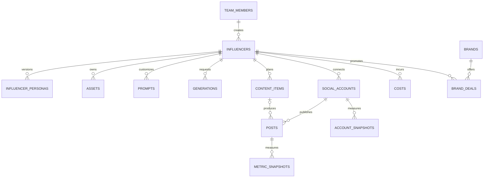

# Admin Panel Veri Modeli

Bu belge `supabase/migrations/20261021090000_initial_schema.sql` ile kurulan ilk sürüm şemasını açıklar. Proje ilk sürümde tek ekip/workspace içindir; bütün uygulama kayıtları aynı takım üyeliği ve RLS sınırını paylaşır.

## İlişkiler

`influencers.avatar_asset_id`, `generations.output_asset_id` ve `posts.content_item_id` isteğe bağlıdır. Üretilen varlıkları silmek, geçmiş üretim kayıtlarını silmez; varlık bağlantısı `NULL` olur.

## Tablolar

| Tablo                   | Sorumluluk                                     | Önemli kurallar                                                                                                                                                   |
| ----------------------- | ---------------------------------------------- | ----------------------------------------------------------------------------------------------------------------------------------------------------------------- |
| `team_members`          | Supabase Auth kullanıcısının rolü              | `owner`, `editor`, `viewer`; son owner silinemez. İlk doğrulanmış kullanıcı yalnızca boş workspace'te owner olarak kaydolabilir.                                  |
| `influencers`           | Karakterin kimliği ve yaşam döngüsü            | Benzersiz URL dostu `slug`; durum `draft`, `active`, `paused`, `archived`.                                                                                        |
| `influencer_personas`   | Persona metni ve versiyonları                  | Influencer başına versiyon numarası benzersiz; aynı anda en fazla bir güncel sürüm.                                                                               |
| `assets`                | Storage'daki görsel/video metadata'sı          | `storage_path` benzersiz; dosyanın kendisi private Storage bucket'ta tutulur.                                                                                     |
| `prompts`               | Global veya influencer'a özel prompt sürümleri | Soy = kapsam + kategori + `key`; versiyon başına bir satır. Versiyon içeriği **değiştirilemez** (trigger), yeni versiyon `create_prompt_version()` ile. Puan 1–5. |
| `generations`           | Görsel/video üretim isteği ve sonucu           | Sağlayıcı, durum, kredi, süre ve çıktı asset'i kaydedilir. `params` (jsonb) doldurulmuş prompt ve değişken değerlerini taşır; sır tutulmaz.                       |
| `social_accounts`       | Instagram, YouTube ve TikTok hesapları         | Token değeri değil, Vault secret referansı (`token_ref`) tutulur.                                                                                                 |
| `content_items`         | Fikirden yayına içerik akışı                   | Stage enum'u: `idea` → `script` → `production` → `qc` → `edit` → `scheduled` → `published`.                                                                       |
| `posts`                 | Platformda yayınlanmış içerik                  | Hesap ve platform kimliğiyle eşleşir; içerik planından bağımsız içe aktarılabilir.                                                                                |
| `metric_snapshots`      | Post bazında zamanlı performans                | `views`, `likes`, `comments`, `shares`, `saves`; completion rate 0–1 aralığında.                                                                                  |
| `account_snapshots`     | Hesap seviyesinde takipçi ve erişim            | Hesap + zaman damgası başına tek snapshot.                                                                                                                        |
| `costs`                 | Abonelik, kredi ve araç maliyeti               | Tutar ve para birimi sayısal alanlardır; üretim kaydına bağlanabilir (üretim başına en fazla bir kayıt, biten üretimde otomatik yazılır).                         |
| `brands`                | Marka ve iletişim notları                      | İsim büyük/küçük harf duyarsız benzersizdir.                                                                                                                      |
| `brand_deals`           | Marka iş birliği süreci                        | Aşama, ücret, teslimatlar ve son tarih tutulur.                                                                                                                   |
| `alerts`                | Panel uyarıları                                | Tür listesi CHECK ile sabit (`ALERT_TYPES`); `dedupe_key` benzersiz; payload sadece id/sayı. Satırlar değiştirilmez.                                              |
| `alert_reads`           | Kişi başı okundu bilgisi                       | `(alert_id, user_id)`; kullanıcı sadece kendi kaydını görür/yazar, viewer dahil.                                                                                  |
| `notification_settings` | Uyarı eşikleri ve push kanal seçimi            | Tek satır. Ekip okur, owner/editor günceller. Kanal sırları Vault'ta.                                                                                             |
| `budgets`               | Aylık bütçe tavanı                             | `influencer_id` NULL = tüm ekip toplamı. Ay başına tek bütçe (kısmi benzersiz indeksler). Sadece owner yazar.                                                     |
| `exchange_rates`        | Döviz kuru                                     | 1 `currency` = `rate` `base_currency`, `valid_on` gününden itibaren. Ters kur otomatik kullanılır. Sadece owner yazar.                                            |
| `credit_rates`          | Sağlayıcı kredisinin para karşılığı            | 1 kredi = `rate_per_credit` `currency`, `valid_from`'dan itibaren (`credits_to_money()`). Sadece owner yazar.                                                     |

Uygulama tablolarının tümünde `created_at`, `updated_at` ve `created_by` bulunur. `updated_at` trigger ile değiştirilir; `created_by` istemci isteklerinde `auth.uid()` ile dolar, demo seed kayıtlarında boş kalır.

## Persona versiyonlama (#44)

`influencer_personas` satırları **değişmez kayıtlardır**:

- Yeni versiyon yalnızca `create_persona_version(...)` RPC'siyle oluşturulur. Versiyon numarası (`max + 1`), `is_current` ve değiştiren kişi (`created_by`) veritabanında belirlenir. RPC influencer satırını `FOR UPDATE` ile kilitler, böylece eşzamanlı iki kayıt aynı numarayı alamaz.
- Geri alma (`restore_persona_version`) eski içeriği kopyalayan **yeni** bir versiyon oluşturur ve `restored_from_version` alanına kaynağı yazar. Geçmiş doğrusal kalır.
- Var olan satırın içeriği trigger ile kilitlidir. `UPDATE` sadece `is_current`'ı `true → false` yapabilir. Geçmişi sadece owner silebilir.
- `change_note`: versiyon notu (en fazla 500 karakter). `appearance`: görünüm alanları (saç, ten, göz, yüz, vücut, imza aksesuar). #43 wizard'ı da bu kolonu kullanır. `sample_captions`: persona tonunu örnekleyen, en fazla 10 caption (her biri en fazla 2.200 karakter); persona sürümüyle birlikte saklanır ve geri yüklenir.
- Panel tarafında form şeması `apps/panel/src/lib/persona.ts`, versiyon farkı `apps/panel/src/lib/persona-diff.ts` içindedir. jsonb alanlarındaki bilinmeyen anahtarlar yeni versiyona taşınır.

## İçerik akışı ve yayın takvimi (#57)

- `content_items`: trend URL/izlenme/viral neden/uyarlama puanı, sorumlu ekip üyesi, hedef sosyal hesap, IANA saat dilimi, sıra ve not alanları. Influencer sonradan değişmez. `updated_at` atomik kayıt RPC’sinde iyimser kilittir; eski sürümle kayıt 409 döner.
- `content_item_assets`: bir içerik ile aynı influencer’a ait asset veya üretimi bağlar (her satırda tam biri). RLS, audit trigger’ları ve tekil bağlantı kısıtları vardır.
- `posting_slots`: hesap, haftanın günü (Pazar=0), PostgreSQL `time` ve IANA saat dilimi. Viewer yalnız okur. DST’de mevcut olmayan slot saati takvimde uyarı olarak gösterilir.
- `save_content_item`: içerik ve medya bağlantılarını tek transaction’da kaydeder. `link_content_post`: `posts.content_item_id` üzerinden yayını eşleştirir; hesabı doğrular ve kartı Yayında’ya taşır. Fonksiyonlar `SECURITY INVOKER` kullanır.
- `checklist` biçimi: `{ items: { <madde>: boolean }, hookScore: 1..5 | null, engagementScore: 1..5 | null, decision: 'ready' | 'rework' | 'review' }`. Maddeler `templates/pre-publish-checklist.md` ile eşleşir. Eksik checklist, düşük puan, eksik hesap/zaman veya post eşleştirmesi planlama/yayın aşamasına geçişi veritabanında da engeller (API 422).
- 5 saat ve günlük 4 paylaşım kuralları uyarıdır. Planlanmış içerik ve gerçek postlar hesap bazında tek kez sayılır; günlük sınır kartın hedef saat diliminde hesaplanır. `content_item_details` yalnız seçili kartlar için son post snapshot’ını getirir; snapshot’lar toplanmaz.
- Kanban ve takvim 100 kartlık sayfalar kullanır; medya ve post seçimleri son 200 kayıtla sınırlıdır. Daha eski bağlı medyanın kimliği korunur.

## Prompt kütüphanesi (#46)

- **Soy (lineage):** `(influencer_id, category, key)`. `influencer_id` NULL ise global. Aynı kapsam ve kategoride farklı `key`'lerle birden çok prompt olabilir.
- **Versiyonlama:** `public.create_prompt_version(...)` (security invoker) bir sonraki versiyon numarasını advisory lock altında atomik olarak verir. Numara istemcide hesaplanmaz. Var olan satırda `body`, `negative`, `variables`, kapsam, kategori, `key` ve `version` değiştirilemez (`prompts_prevent_content_update`). Sadece `title`, `rating` ve `change_note` güncellenir. Böylece geçmiş üretimlerin bağlı olduğu metin değişmez.
- **Görünümler** (ikisi de `security_invoker = true`, ekip dışına satır göstermez):
  - `prompt_lineages`: her soyun en son versiyonu + `version_count`.
  - `prompt_stats`: versiyon başına `total`, `succeeded`, `failed`, `pending`, `success_rate` = başarılı / (başarılı + başarısız) (biten üretim yoksa NULL), `avg_credits` (sadece başarılılar).
- **Şablon sözdizimi:** `{{degisken}}`, kaçış `\{{`. Motor: `apps/panel/src/lib/prompt-template.ts`.
- **İçe/dışa aktarma:** `/prompts` sayfasından seçilen veya filtredeki tüm prompt'ların son versiyonları tek bir JSON paketi olarak indirilir (`GET /api/prompts/export`, ekip üyesi). Paket aynı sayfadan geri yüklenir (`POST /api/prompts/import`, en az editor): her prompt `create_prompt_version()` ile yeni versiyon olur, son versiyonla aynı içerik atlanır. Paket önce bütünüyle doğrulanır (Zod, `apps/panel/src/lib/prompt-bundle.ts`); tek hata varsa hiçbir şey yazılmaz. Influencer'lar ortamlar arası `slug` ile taşınır. **Repo public olduğu için prompt dosyaları repoya commit'lenmez** (`.gitignore`: `/prompts/`, `ai-influencer-prompts-*.json`); ekibin kısıtlı paylaşım alanında saklanır.
- **AI asistanı:** görev → soy eşlemesi `docs/AI.md` → Yapılandırma.

## Maliyet ve bütçe (#59)

- Para her yerde `numeric`. Farklı para birimleri dönüşümsüz toplanmaz: `cost_entries_converted()` her kaydı `incurred_on` gününün kuruyla (`fx_rate()`) hedef para birimine çevirir. Kuru bulunamayan kayıt sayılır ve toplamlar `NULL` döner, panel "eksik kur" uyarısı gösterir.
- Özetler SQL'de hesaplanır (`cost_summary`, `cost_daily`, `cost_by_category`, `budget_status`). Hepsi `SECURITY INVOKER`, çağıranın RLS'i geçerli.
  - **Video başına maliyet (dönem):** dönem toplam maliyeti / dönemde yayınlanan post sayısı (`cost_summary.cost_per_video`).
  - **Post başına maliyet:** `post_cost(post_id, currency)` (panelde `getPostCost()`, `apps/panel/src/lib/costs/post-cost.ts`). Bağ: post → `content_item_id` → `content_item_assets` → üretim (doğrudan `generation_id` veya `asset_id = generations.output_asset_id`). Bağlı üretim varsa `allocation = 'direct'` ve toplam bu üretimlerin maliyet kayıtlarıdır; aynı içerik birden çok hesapta yayınlandıysa her post içeriğin tüm maliyetini gösterir (bölüştürülmez). Bağlı üretim yoksa `allocation = 'average'` ve postun yayın ayındaki influencer ortalaması döner. `SECURITY INVOKER`: ekip dışı kullanıcıya satır dönmez.
  - **1000 izlenme başına:** toplam maliyet × 1000 / dönemde yayınlanan postların en son izlenme toplamı.
  - **Başarısız üretim:** `generations.status = 'failed'` olan üretimler sayılır. Kredileri ve bağlı `costs` kayıtları toplama dahildir, ayrıca raporlanır.
- **Bütçe uyarıları:** `costs` veya `budgets` değişince trigger `raise_budget_alerts()`'ı çalıştırır. Oran `warn_ratio`'yu (varsayılan 0.8) geçince `budget_warning`, 1'i geçince `budget_exceeded` yazılır. Aynı bütçe, ay ve seviye için tek kayıt oluşur (`alerts_budget_dedupe_idx`). Uyarıyı tarayıcı değil veritabanı üretir.
- **Üretim maliyeti otomatik:** `generations` satırı `succeeded` veya `failed` olduğunda ve `credits > 0` ise trigger (`generations_record_cost`) `costs`'a tek bir `credits` kaydı yazar: tutar `credits_to_money(tool, credits, üretim günü)`, `generation_id` bağlı, `incurred_on` = üretimin oluşturulduğu gün. Başarısız üretim de yazılır (kredi harcanmıştır); `cancelled` ve kredisiz üretim yazılmaz. `costs.generation_id` benzersizdir: durum tekrar değişse veya kredi sonradan güncellense de ikinci kayıt oluşmaz, mevcut kayıt ezilmez. Kredi fiyatı yoksa kayıt yazılmaz (yanlış 0 yerine); owner `credit_rates`'e fiyat girince `valid_from`'dan itibaren biten ve kaydı olmayan üretimler otomatik tamamlanır. Fiyat değişikliği eski kayıtları yeniden fiyatlandırmaz.
- AI API maliyeti `cost_category = 'ai_api'` ile kaydedilir (`recordAiUsage()`, `/api/ai/suggest` her Claude çağrısından sonra çağırır; yazılamazsa öneri dönmez).

## Bildirimler (#56)

Migration: `20261022210000_notifications.sql`. Uyarıyı tarayıcı üretmez; üreticiler veritabanındadır ve API rollerine kapalı `private` şemasında `SECURITY DEFINER` fonksiyonlardır. Her uyarı `private.raise_alert()` ile `dedupe_key` üzerinden tekrarsız yazılır.

| Tür                                  | Ne zaman                                                                                                                                  | `dedupe_key`                                  |
| ------------------------------------ | ----------------------------------------------------------------------------------------------------------------------------------------- | --------------------------------------------- |
| `viral_post`                         | `metric_snapshots` ilk saat (`hours_since_publish <= 1`) izlenmesi, hesabın son 30 postunun ilk saat ortalamasının N katı (en az 3 örnek) | `viral_post:<post_id>`                        |
| `follower_milestone`                 | `account_snapshots` önceki en yüksek değerin üstündeki en büyük eşiği geçince (ilk snapshot temel alınır)                                 | `follower_milestone:<account_id>:<eşik>`      |
| `token_expiring`                     | `social_accounts.token_expires_at` ayardaki gün sayısından yakınsa (trigger + pg_cron)                                                    | `token_expiring:<account_id>:<bitiş günü>`    |
| `sync_failed`                        | `social_accounts.status` `error` olunca (sync işi yazar)                                                                                  | `sync_failed:<account_id>:<gün>`              |
| `budget_warning` / `budget_exceeded` | Bütçe oranı `warn_ratio` (varsayılan %80) / %100 (#59, `alerts_budget_dedupe_idx`)                                                        | —                                             |
| `content_not_ready`                  | Son 24 saatte yayın saati gelen, `scheduled`/`published` olmayan içerik (pg_cron, 15 dk)                                                  | `content_not_ready:<id>:<scheduled_at epoch>` |
| `generation_failed`                  | `generations.status` `failed` olunca                                                                                                      | `generation_failed:<id>`                      |

- **Okundu kararı:** kişi başı (`alert_reads`). Viewer da kendi okundu kaydını yazar, `alerts` satırına UPDATE politikası yoktur. `alerts.read_at` kullanılmaz. RPC'ler: `mark_alerts_read(p_alert_ids uuid[] DEFAULT NULL)` (NULL = tümü) ve `unread_alert_count()`; ikisi de `SECURITY INVOKER`.
- **Zamanlayıcı:** `pg_cron` işi `raise-scheduled-alerts` 15 dakikada bir `private.raise_scheduled_alerts()` çalıştırır.
- **Push (opsiyonel):** Yeni uyarıda `notification_settings`'te açık olan ve sırrı tanımlı kanallara `pg_net` ile asenkron istek gider. Metin sadece uyarı başlığıdır (isim/token yok). Kanal hatası (istek oluşturulamaması veya sağlayıcının 500 dönmesi) uyarı yazımını etkilemez; loga adres/token yazılmaz. Sırlar Supabase Vault'ta (Dashboard → Vault) şu adlarla tutulur:

  | Kanal    | Vault sır adları                                                                      |
  | -------- | ------------------------------------------------------------------------------------- |
  | ntfy     | `notify_ntfy_url` (`https://sunucu/konu`), ops. `notify_ntfy_token`                   |
  | Telegram | `notify_telegram_bot_token`, `notify_telegram_chat_id`                                |
  | E-posta  | `notify_resend_api_key`, `notify_email_from`, `notify_email_to` (virgülle birden çok) |

- **Panel:** üst bardaki zil (`components/notifications.tsx`, 60 sn'de bir yenilenir), `/notifications` listesi ve `/settings/notifications` (eşikler + kanal seçimi, owner/editor). API: `GET /api/alerts`, `POST /api/alerts/[id]/read`, `POST /api/alerts/read-all`, `GET|PUT /api/notification-settings`.
- **Yeni tür eklerken:** migration'da `alerts_type_known` CHECK'ini ve `private.alert_push_title()`'ı, `packages/shared/src/alerts.ts`'teki `ALERT_TYPES`'ı ve `apps/panel/src/lib/alerts/format.ts`'i birlikte güncelle (Vitest listelerin eşitliğini denetler).

## Yetki matrisi

| Rol                 | Uygulama verisini okuma | Uygulama verisi yazma | Takım üyelerini yönetme |
| ------------------- | ----------------------- | --------------------- | ----------------------- |
| `owner`             | Evet                    | Evet                  | Evet                    |
| `editor`            | Evet                    | Evet                  | Hayır                   |
| `viewer`            | Evet                    | Hayır                 | Hayır                   |
| Takım dışı / `anon` | Hayır                   | Hayır                 | Hayır                   |

Her uygulama tablosunda RLS açıktır. Anon rolüne tablo yetkisi verilmez; `authenticated` rolü tabloya erişse bile RLS yalnızca `team_members` içindeki kullanıcılara satır gösterir. Viewer için yazma politikası yoktur. Supabase `service_role` anahtarı RLS'i baypas edebildiği için sadece güvenilir sunucu işlerinde kullanılmalı ve asla tarayıcıya verilmemelidir.

## Yerel geliştirme ve tip üretimi

`assets.qc_checklist` QC kontrol yanıtlarını, `assets.thumbnail_path` ise private `assets` bucket'ındaki küçük resim yolunu tutar. Storage erişim politikaları üyeler için okuma, owner/editor için yazma ve silme izni verir. Yazma sadece var olan bir influencer'ın klasörüne (`<influencer_id>/<dosya>`, tek seviye) yapılabilir. `assets` satırındaki yollar da aynı influencer klasöründe olmak zorundadır (`assets_paths_in_influencer_folder`). Silmede önce satır, sonra dosya kaldırılır. Avatar bağlantısını FK (`ON DELETE SET NULL`) temizler.

`pnpm supabase:start` yerel Supabase'i başlatır. `pnpm supabase:db-reset` migration'ları ve `supabase/seed.sql` demo verisini sıfırdan uygular. `pnpm supabase:test` pgTAP testlerini çalıştırır; testler ilk owner kaydı, viewer salt-okunur davranışı, takım dışı erişim ve editor yazma yetkisini kontrol eder.

Şema değiştikten sonra `pnpm supabase:types` komutu `supabase gen types typescript --local` çıktısını `packages/shared/src/database.types.ts` dosyasına yazar. Bu dosya **elle düzenlenmez**; CI, migration'lardan üretilen tiplerle dosyanın aynı olduğunu kontrol eder ve fark varsa PR'ı düşürür. `Row<'influencers'>`, `TeamRole` gibi yardımcı tipler `packages/shared/src/database.ts` içindedir; panel kodu her zaman `@ai-influencer/shared` üzerinden import eder.

## Kapsam sınırları

- Bu model tek bir ortak ekip içindir. Birden çok müşteri/ekip workspace'i gerekirse her iş tablosuna `team_id` eklenmeli ve RLS politikaları workspace üyeliğine göre yeniden kurulmalıdır.
- Sosyal OAuth token'ları bu şemaya düz metin olarak yazılmaz; Vault secret adı veya kimliği `token_ref` alanında tutulur.
- Storage bucket oluşturma, dosya yükleme politikaları ve asset kullanıcı akışı #45 kapsamındadır.
- Paylaşım ve OAuth entegrasyonlarına özel alanlar, kendi issue'larında sağlayıcı koşulları doğrulandıkça migration ile eklenmelidir.

### Sosyal hesap token kasası (#49, altyapı)

`20261022160000_oauth_vault_helpers.sql`, token paketini Vault'ta şifreli tutar.
`social_accounts.token_ref` yalnız Vault UUID'sini içerir. Token paketinde yalnız
`access_token` ve isteğe bağlı `refresh_token`, `token_type`, `scope` metinleri kabul edilir;
sağlayıcı yanıtının tamamı saklanmaz. Tarih verilirse gelecekte ve sonlu olmalıdır.

Yalnız `service_role` şu RPC'leri çağırabilir (hepsi sabit, boş `search_path` kullanır):

| RPC                                                       | Davranış                                                                                                                                                                                                                                            |
| --------------------------------------------------------- | --------------------------------------------------------------------------------------------------------------------------------------------------------------------------------------------------------------------------------------------------- |
| `store_social_token(p_account_id, p_token, p_expires_at)` | Hesabı kilitler; aynı hesaba ait sırrı oluşturur/günceller, UUID referansı ve son kullanım tarihiyle hesabı `active` yapar. Paket bütünüyle değiştirilir; yenileme yanıtında refresh token yoksa çağıran sunucu önceki refresh token'ı korumalıdır. |
| `read_social_token(p_account_id)`                         | Hesap referansı **ve** `social-token:<account_id>` adı eşleşirse paketi çözer; yoksa/revoked ise NULL döner. Süresi dolmuş token yenileme için okunabilir. Sonuç API yanıtına, istemciye veya loga yazılmaz.                                        |
| `delete_social_token(p_account_id)`                       | Sırrı siler; referans/tarihi temizler ve hesabı `revoked` yapar. Hesap ve post geçmişini silmez; tekrar çağrılabilir. Sağlayıcıdaki revoke isteğinin yerini tutmaz.                                                                                 |

Vault şeması ve tablolarına `anon` ve `authenticated` doğrudan erişemez.
`service_role` güvenilen sunucu rolüdür; platformun verdiği geniş yetkiler korunur.
Uygulama kodu token işlemlerini yukarıdaki dar RPC'lerden yapar. Owner/editor da
istemci rolü `authenticated` olduğu için token referansı, son kullanım tarihi ve bağlantı
durumunu elle değiştiremez. Normal metadata düzenlemesi ve yeni `pending` hesap ekleme
korunur. Token bağlıyken influencer/platform değiştirilmesi engellenir.

Hesap silinince (influencer CASCADE dahil) yalnız o hesabın adıyla eşleşen Vault sırrı
trigger ile temizlenir. Bir hesabın bozuk referansı başka hesabın sırrını okuyamaz/silemez.
Saklama ve silme aynı hesap kilidini kullanır; Vault yazımı ve hesap güncellemesi tek
transaction'dır. RPC hataları token paketini içermez.

Bu migration sağlayıcı uygulaması, OAuth start/callback, state/PKCE, refresh job'u veya
canlı ortam secret'ı kurmaz. Bunlar #49'un kalan adımlarıdır. RPC'ler doğrulanmış OAuth
callback'i/yenileme job'u için sunucu altyapısıdır; tarayıcıdan çağrılmaz.

Kaynak: [Supabase Vault resmi dokümanı](https://supabase.com/docs/guides/database/vault)
(okuma: 2026-10-21). pgTAP `oauth_vault.test.sql`: rol sınırları, şifreleme/rotasyon,
referans izolasyonu, girdi doğrulaması, bağlantıyı kaldırma ve cascade temizliği.

### AI asistanı (#48)

`app_settings`: `key='ai'` tekil ayarı, model ID ve USD token fiyatlarını `value` JSON'unda
tutar. API anahtarı içermez. Ekip SELECT yapar; yalnız owner INSERT/UPDATE/DELETE yapabilir.
Audit trigger'ları `created_by` ve `updated_at` alanlarını yönetir. Geçersiz/eksik model
ve fiyatlarda sunucu sabit varsayılana dönmez. Ayarlar API'si Zod şemasıyla doğrular.

`ai_weekly_summary(influencer_id, as_of)` SECURITY INVOKER RPC'si son 7 günün sayısal
özetini veritabanında hesaplar. Snapshot'ları toplamak yerine post başına baseline ile
son ölçümün farkını alır; eksik baseline kapsamını döndürür. RLS nedeniyle ekip dışı
kullanıcıya özet döndürmez. Ayrıntılar ve çağrı/maliyet sözleşmesi: [AI rehberi](AI.md).

### Genel bakış dashboard’u (#54)

`dashboard_overview(from, to, influencer_slug?, platform?)` yalnız authenticated
üyelerin çağırabildiği `SECURITY INVOKER` RPC’sidir. RLS bütün alt sorgularda korunur;
istemciye snapshot listesi indirip toplama yapılmaz. Aralık UTC günleri dahil,
en fazla 366 gündür. Bilinmeyen influencer tüm ekibe geri düşmez.

- İzlenme: her postun dönem başı baseline’ı + her UTC gününün **son** snapshot’ı.
  Ardışık gün sonu ölçümleri farkı alınır; negatif fark sıfırlanır. Yeni post sıfırdan
  başlar; eski postun baseline’ı yoksa ilk ölçümü artışa katılmaz. Ölçümsüz gün NULL’dır.
  Geciken snapshot artışı yakalandığı güne yazar; gerçek izlenme gününü tahmin etmez.
- Takipçi: hesap başına dönem sonu son bilinen değer. Bir hesap ölçümsüzse toplam NULL;
  dönem başı baseline eksikse değişim NULL. Grafik aynı kuralı her gün/platform için uygular.
- Etkileşim KPI: dönemde yayınlanan postların son ölçümlerindeki
  `(likes + comments + shares + saves) / views × 100`, izlenmeye göre ağırlıklı.
  Günlük trend, o gün ölçülen postların son ölçümlerini kullanır. Kapsam UI’da belirtilir.
- İlk/son 5: dönemde yayınlanan ve `hours_since_publish` 24–30 olan postların ilk
  ölçümü. #53 hedef saat kolonunu ekleyene kadar bu açık pencere kullanılır.
  Eksik hedef ölçüm sıfır kabul edilmez, sıralamadan çıkarılır.
- Maliyet: para birimi bazında dönem toplamı / dönem platform post sayısı;
  doğrudan video maliyeti dağıtımı değildir. Şemada platform maliyet ataması
  olmadığından platform filtresinde maliyet hesaplanmaz ve açıklama gösterilir.
- Bugünün planı İstanbul takvim gününü, bekleyen işler yayınlanmamış kartları kullanır;
  tarih aralığından bağımsızdır, influencer/platform filtresine uyar. İlk 10 kayıt ve
  toplam sayı döner. Aynı içerik karşılaştırması son kümülatif ölçümleri, ilk 50 içeriği gösterir.

Grafiklerin klavyeyle açılan veri tabloları vardır; renkler tema değişkenlerinden gelir.
`?inf=`, platform ve 7/30/90/özel aralık filtreleri URL’dedir. Salt okuyan viewer da
aynı dashboard’u kullanır. Yeni bağımlılık veya ortam anahtarı eklenmedi.
