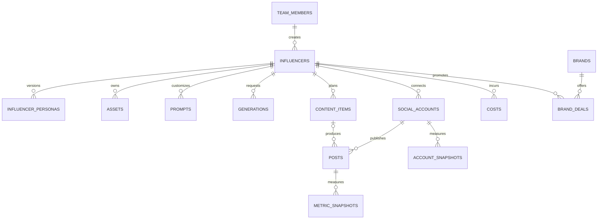

# Admin Panel Veri Modeli

Bu belge `supabase/migrations/20261021090000_initial_schema.sql` ile kurulan ilk sürüm şemasını açıklar. Proje ilk sürümde tek ekip/workspace içindir; bütün uygulama kayıtları aynı takım üyeliği ve RLS sınırını paylaşır.

## İlişkiler

`influencers.avatar_asset_id`, `generations.output_asset_id` ve `posts.content_item_id` isteğe bağlıdır. Üretilen varlıkları silmek, geçmiş üretim kayıtlarını silmez; varlık bağlantısı `NULL` olur.

## Tablolar

| Tablo                 | Sorumluluk                                     | Önemli kurallar                                                                                                                  |
| --------------------- | ---------------------------------------------- | -------------------------------------------------------------------------------------------------------------------------------- |
| `team_members`        | Supabase Auth kullanıcısının rolü              | `owner`, `editor`, `viewer`; son owner silinemez. İlk doğrulanmış kullanıcı yalnızca boş workspace'te owner olarak kaydolabilir. |
| `influencers`         | Karakterin kimliği ve yaşam döngüsü            | Benzersiz URL dostu `slug`; durum `draft`, `active`, `paused`, `archived`.                                                       |
| `influencer_personas` | Persona metni ve versiyonları                  | Influencer başına versiyon numarası benzersiz; aynı anda en fazla bir güncel sürüm.                                              |
| `assets`              | Storage'daki görsel/video metadata'sı          | `storage_path` benzersiz; dosyanın kendisi private Storage bucket'ta tutulur.                                                    |
| `prompts`             | Global veya influencer'a özel prompt sürümleri | Kategori + scope + version benzersiz; negatif prompt ve değişkenler ayrı alanlarda.                                              |
| `generations`         | Görsel/video üretim isteği ve sonucu           | Sağlayıcı, durum, kredi, süre ve çıktı asset'i kaydedilir. `token_ref` benzeri alanlarda sır tutulmaz.                           |
| `social_accounts`     | Instagram, YouTube ve TikTok hesapları         | Token değeri değil, Vault secret referansı (`token_ref`) tutulur.                                                                |
| `content_items`       | Fikirden yayına içerik akışı                   | Stage enum'u: `idea` → `script` → `production` → `qc` → `edit` → `scheduled` → `published`.                                      |
| `posts`               | Platformda yayınlanmış içerik                  | Hesap ve platform kimliğiyle eşleşir; içerik planından bağımsız içe aktarılabilir.                                               |
| `metric_snapshots`    | Post bazında zamanlı performans                | `views`, `likes`, `comments`, `shares`, `saves`; completion rate 0–1 aralığında.                                                 |
| `account_snapshots`   | Hesap seviyesinde takipçi ve erişim            | Hesap + zaman damgası başına tek snapshot.                                                                                       |
| `costs`               | Abonelik, kredi ve araç maliyeti               | Tutar ve para birimi sayısal alanlardır; üretim kaydına bağlanabilir.                                                            |
| `brands`              | Marka ve iletişim notları                      | İsim büyük/küçük harf duyarsız benzersizdir.                                                                                     |
| `brand_deals`         | Marka iş birliği süreci                        | Aşama, ücret, teslimatlar ve son tarih tutulur.                                                                                  |
| `alerts`              | Panel uyarıları                                | Tip serbest metindir; payload JSONB'dir, okundu zamanı `read_at` ile saklanır.                                                   |

Uygulama tablolarının tümünde `created_at`, `updated_at` ve `created_by` bulunur. `updated_at` trigger ile değiştirilir; `created_by` istemci isteklerinde `auth.uid()` ile dolar, demo seed kayıtlarında boş kalır.

## Yetki matrisi

| Rol                 | Uygulama verisini okuma | Uygulama verisi yazma | Takım üyelerini yönetme |
| ------------------- | ----------------------- | --------------------- | ----------------------- |
| `owner`             | Evet                    | Evet                  | Evet                    |
| `editor`            | Evet                    | Evet                  | Hayır                   |
| `viewer`            | Evet                    | Hayır                 | Hayır                   |
| Takım dışı / `anon` | Hayır                   | Hayır                 | Hayır                   |

Her uygulama tablosunda RLS açıktır. Anon rolüne tablo yetkisi verilmez; `authenticated` rolü tabloya erişse bile RLS yalnızca `team_members` içindeki kullanıcılara satır gösterir. Viewer için yazma politikası yoktur. Supabase `service_role` anahtarı RLS'i baypas edebildiği için sadece güvenilir sunucu işlerinde kullanılmalı ve asla tarayıcıya verilmemelidir.

## Yerel geliştirme ve tip üretimi

`pnpm supabase:start` yerel Supabase'i başlatır. `pnpm supabase:db-reset` migration'ları ve `supabase/seed.sql` demo verisini sıfırdan uygular. `pnpm supabase:test` pgTAP testlerini çalıştırır; testler ilk owner kaydı, viewer salt-okunur davranışı, takım dışı erişim ve editor yazma yetkisini kontrol eder.

Şema değiştikten sonra `pnpm supabase:types` komutu `supabase gen types typescript --local` çıktısını `packages/shared/src/database.types.ts` dosyasına yazar. Bu dosya **elle düzenlenmez**; CI, migration'lardan üretilen tiplerle dosyanın aynı olduğunu kontrol eder ve fark varsa PR'ı düşürür. `Row<'influencers'>`, `TeamRole` gibi yardımcı tipler `packages/shared/src/database.ts` içindedir; panel kodu her zaman `@ai-influencer/shared` üzerinden import eder.

## Kapsam sınırları

- Bu model tek bir ortak ekip içindir. Birden çok müşteri/ekip workspace'i gerekirse her iş tablosuna `team_id` eklenmeli ve RLS politikaları workspace üyeliğine göre yeniden kurulmalıdır.
- Sosyal OAuth token'ları bu şemaya düz metin olarak yazılmaz; Vault secret adı veya kimliği `token_ref` alanında tutulur.
- Storage bucket oluşturma, dosya yükleme politikaları ve asset kullanıcı akışı #45 kapsamındadır.
- Paylaşım ve OAuth entegrasyonlarına özel alanlar, kendi issue'larında sağlayıcı koşulları doğrulandıkça migration ile eklenmelidir.
